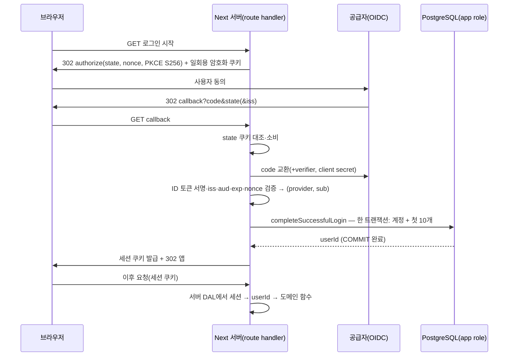

# PLAN — F4 인증·세션·첫 로그인 지급 연결 (중립 계획, 선택 대기)

- 상태: **검토용 중립 초안이다. F4 착수 승인 문서도, 실제 인증 완료 문서도 아니다.** 코드·의존성·SQL·환경은 바꾸지 않았다.
- BASE: `dev` `76a39d1e65a889a03eb1e5bd64a7e0b3ef161800`.
  - F3 최종 제품 커밋 `c69384f`: 단위 103 · DB 99 · Node 24/26 prod 6 · E2E 12 · root 42 통과(메인 전달).
  - 앱 CI(41549378945)는 배정 시점에 진행 중이었다. 이 문서는 그 결과를 확인하지 않았다.
  - 앱은 정적 dev와 별개다. 실서버 DB·OAuth·세션·HTTP 연결·화면 저장 연결은 없다.
- 근거 문서: [PLAN_mvp-foundation](PLAN_mvp-foundation.md) F4·G4, [PLAN_mvp-domain-storage](PLAN_mvp-domain-storage.md) §1·§2, [DATA_CONTRACT](../product/DATA_CONTRACT.md), [00_TECH_STACK_DECISION](../product/00_TECH_STACK_DECISION.md), [03_MVP](../product/03_MVP.md), [PRD](../PRD.md).
- **로그인 공급자(Google / Kakao / 둘 다)는 사용자 답변 대기다.** 무응답이나 첫 선택지를 승인으로 보지 않는다. 그래서 이 문서는 공급자와 라이브러리를 확정하지 않는다.
- 표기:
  - **[확정]** 사용자나 정본이 정한 것
  - **[사실]** 코드·공식 문서로 확인한 것
  - **[권고]** 이 계획의 제안이며 메인 결정 대상
  - **[미정]** 사용자 결정이 필요한 것
  - **[미확인]** 확인하지 못한 것

## 0. 결정 상태

| 구분 | 내용 |
|---|---|
| [확정] | TypeScript·React/Next.js + PostgreSQL + 전용 이미지 저장소 + Konva, D 테마. 감정덩어리는 **계정당 첫 성공 로그인에 10개 한 번**. 실제 로그인 연결과 지급 켜기는 같은 F4 범위다(PLAN_mvp-foundation F4) |
| [미정] 사용자 | 로그인 공급자, 여러 공급자 계정의 자동 연결 여부, 사진·공유·AI 전송, 탈퇴 처리 |
| [미정] 메인 | 인증 라이브러리, 세션 방식(무상태 쿠키 / DB 세션), `server-only` 도입 여부, 세션 만료 기본값 |
| 바꾸지 않는 것 | 다른 문서에 정의된 F3 공개 계약, F2 권한 계약, 정적 dev 배포, 운영 준비중 페이지 |

## 1. 현재 코드 사실 (BASE 기준)

| 항목 | 사실 |
|---|---|
| 계정 해석·지급 | `app/src/server/account/login.ts`의 `completeSuccessfulLogin(db, { provider, subject })`가 `Result<{ userId, createdUser, granted, balance }, "invalid_identity">`를 돌려준다. user·identity·계정·원장·잔액·`first_login_at`을 한 트랜잭션에서 처리하고, 생성 경합이 나면 한 번 재시도한다 |
| identity 형식 | `provider`는 `^[a-z][a-z0-9_-]{0,31}$`, `subject`는 1~255 코드포인트. `google`·`kakao`는 이 형식에 맞는다 |
| 스키마 | `pod.users`에 email·이름 열이 없다. 세션 테이블도 없다. app role은 `auth_identities`에 `SELECT, INSERT`만 갖는다. 이 범위가 F2 계약이다 |
| DB 접속 | `server/db/pool.ts`의 `getAppDb()`가 `POD_DATABASE_URL`(app role)만 읽는다. 아직 호출하는 곳이 없다 |
| 요청 문맥 | `server/context.ts`의 `getDiaryContext()`는 로컬 fixture(개발·시험 전용, 운영 빌드에서는 거부)가 아니면 `{ kind: "unavailable" }`를 돌려준다 |
| client 경계 | ESLint 규칙이 `src/ui/**`·`src/shared/**`에서 server를 직접 import하지 못하게 막는다. 전이 import는 보장하지 않는다(F3 §1 한계) |

## 2. 공급자 중립 핵심 흐름

- **신뢰 경계:** `userId`는 서버가 검증한 세션에서만 얻는다. 클라이언트가 보낸 form·URL·헤더의 userId나 identity는 신뢰하지 않는다. `completeSuccessfulLogin`은 6단계(callback 검증 성공 뒤)에서만 호출한다.
- **subject:** Google과 Kakao 모두 ID 토큰의 `sub`를 쓴다. Kakao `sub`는 회원번호다. email·닉네임은 식별이나 동일인 판단에 쓰지 않는다. 두 공급자 공식 문서 모두 email을 식별자로 쓰지 말라고 한다.
- **첫 성공 로그인의 정의 [권고]:** "공급자 검증이 성공하고 `completeSuccessfulLogin` COMMIT까지 성공한 순간"이다.
  - DB COMMIT과 브라우저의 쿠키 수신은 한 트랜잭션이 아니다. 그래서 세션 발급 성공을 지급 조건으로 묶을 수 없다.
  - 이 정의에서 재시도는 멱등이다. 같은 `(provider, sub)`는 같은 userId로 해석되고 `granted=false`가 된다(F3에서 시험됨).

| 사건 | DB에 남는 것 | 브라우저 | 다음 시도 |
|---|---|---|---|
| 사용자가 동의 취소(`error=access_denied` 등) | 없음 | 로그인 화면 + 안내 | 정상 |
| state 없음·불일치·재사용, 위조 callback | 없음(DB 호출 전에 거부) | 400·로그인 화면 | 정상 |
| code 교환·서명·iss·aud·exp·nonce 실패 | 없음 | 로그인 실패 안내 | 정상 |
| DB 오류(트랜잭션 롤백) | 없음 | 일시 오류 안내, 세션 없음 | 정상 지급 1회 |
| COMMIT 뒤 세션 발급·응답 실패 | user·identity·지급 유지 | 로그아웃 상태 | 같은 userId, 추가 지급 없음 |
| callback 새로고침·중복 요청 | 처음 처리 결과만 남음 | 두 번째 요청은 state 소비됨으로 거부 | — |
| 로그아웃 | 세션 무효화(방식에 따름) | 쿠키 삭제 | 정상 |

## 3. 보안 요건 (공급자·라이브러리 무관)

출처는 §10. 어떤 라이브러리를 고르든 아래를 시험으로 확인한다.

- **authorization code + PKCE S256**을 쓴다. RFC 9700은 confidential client에도 PKCE를 권장하고 S256만 verifier를 노출하지 않는다고 한다.
  - Google discovery 문서는 `S256`을 지원한다.
  - Kakao REST 문서에서는 PKCE 지원을 확인하지 못했다 [미확인]. 지원하지 않으면 state와 nonce로 방어하고, 그 사실을 결정 기록에 남긴다.
- **state:** 요청마다 새로 만든 일회용 값이다. 브라우저에 묶인 암호화 쿠키(짧은 만료)에 넣고, callback에서 대조한 뒤 즉시 삭제한다.
- **nonce:** OIDC에서는 요청마다 새로 만들고 ID 토큰의 `nonce`와 대조한다.
- **issuer 확인:** 요청할 때 보낸 issuer를 저장해 두고 callback에서 대조한다(mix-up 방어). ID 토큰의 `iss`는 Google이 `https://accounts.google.com` 또는 `accounts.google.com`, Kakao가 `https://kauth.kakao.com`이다. `aud`는 해당 앱의 client ID와 같아야 한다.
- **redirect URI:** 환경별(로컬 / dev / 운영) 정확한 문자열을 등록하고, 코드는 설정값만 쓴다. 요청 값으로 redirect 대상을 만들지 않고, 로그인 뒤 이동 경로는 앱 내부 상대 경로 허용 목록만 받는다(open redirect 방지).
- **최소 수집 [권고]:**
  - scope는 `openid`만 요청한다. Kakao 동의항목도 최소로 한다. email이 없어도 동작한다(스키마에 email 열 없음).
  - 공급자 access/refresh/ID 토큰은 **저장하지 않는다**. MVP에 공급자 API를 호출하는 기능이 없다.
  - 로그에 code·토큰·쿠키 값을 남기지 않는다.
- **쿠키 [권고]:**
  - `HttpOnly`, `Secure`, `SameSite=Lax`(OAuth 복귀가 최상위 GET이므로), `Path=/`, `__Host-` 접두를 쓴다. 만료를 명시한다.
  - 로컬 http는 개발 예외로 두고 운영 빌드에서는 거부한다.
- **CSRF:** 로그아웃과 상태를 바꾸는 요청은 POST(Server Action·route handler)로만 받고 세션을 확인한다.
  - Next Server Action의 Origin 검사 동작은 버전 문서로 다시 확인한다 [미확인].
  - GET 로그아웃은 만들지 않는다.
- **세션 검증:** 보안 확인은 데이터 가까이의 서버 DAL(`verifySession`)에서 한다. Next 공식 가이드 권장 방식이다. proxy를 쓰더라도 쿠키만 보는 낙관적 redirect용이며 유일한 방어선이 아니다.
- **자동 계정 연결 [미정, MVP 제외 권고]:** 같은 email이라는 이유로 다른 공급자 계정을 자동 연결하지 않는다.
  - email이 바뀌거나 미인증일 수 있어 계정 탈취 위험이 있다. Better Auth 문서도 이 위험을 경고하며 기본값으로 켜 둔다.
  - 둘 다 지원하더라도 MVP에서 공급자마다 별도 canonical 계정이 생긴다. 이것이 사용자에게 받아들여질지가 사용자 결정 대상이다.
- **client 경계 강화 [권고, 메인 결정]:**
  - 세션·DAL 모듈에 `server-only`(Next 가이드 권장, npm 0.0.1)를 import해 client 번들에 들어가면 빌드가 실패하게 한다. 새 의존성이므로 승인이 필요하다.
  - 기존 ESLint 경로 규칙은 유지한다. 승인되지 않으면 F4에서도 전이 import는 보장 범위 밖이라고 명시한다.

## 4. 세션 방식 (메인 결정)

| 안 | 내용 | 장점 | 단점·영향 |
|---|---|---|---|
| S1 무상태 암호화 쿠키 | `{ userId, issuedAt, expiresAt }`만 서버 비밀로 암호화·서명한다(Next 가이드: jose/iron-session, 또는 라이브러리 내장 JWT) | **F2 스키마 변경 없음**, DB 왕복 없음 | 서버에서 개별 폐기 불가(로그아웃은 쿠키 삭제뿐), 비밀 회전 시 전원 로그아웃 |
| S2 DB 세션 | 쿠키에는 임의 토큰만 두고 DB에는 그 SHA-256 해시를 저장한다 | 로그아웃 즉시 무효화, 기기별 폐기 가능 | **F2 계약 변경**: §6의 새 migration과 권한 필요, 요청마다 조회 |

- 만료 [권고]: 7일, 사용하면 연장. Next 가이드 예시와 Better Auth 기본값이 7일이다. 메인이 정한다.
- 세션에는 userId 외에 개인 기록이나 공급자 프로필을 넣지 않는다.
- S1을 고르더라도 감정덩어리 지급과 기록 소유권 판정은 세션의 userId 하나만 쓰므로, 나중에 S2로 바꿔도 F3 계약은 바뀌지 않는다.

## 5. 인증 라이브러리 후보 (기존 Next 스택 안, 선택 대기)

npm 메타데이터와 공식 문서는 2026-11-03에 확인했다. 설치·clone·실행은 하지 않았다.

| 항목 | A. Auth.js(`next-auth`) | B. Better Auth(`better-auth`) | C. `openid-client` + 직접 세션 |
|---|---|---|---|
| 상태·버전 | v5는 `5.0.0-beta.32`로 **베타**(공식 설치 문서가 `@beta` 태그 사용). 안정 `latest`는 v4 `4.24.15` | `latest` 1.7.15(2026-11-01), MIT | `openid-client` 6.8.9(MIT, OpenID 인증 RP). 의존성 `jose`·`oauth4webapi` |
| peer·런타임 | v5 peer `next ^14 \|\| ^15 \|\| ^16`, `react ^18.2 \|\| ^19`. v4도 `next … ^16` | peer `next ^14~^16`, `react ^18 \|\| ^19`, `pg ^8` | Node 20 이상 기본 지원(README). Next·React 무관 |
| Google·Kakao | 내장 provider 둘 다 있다(Kakao 문서 확인) | 내장 둘 다 있다. Kakao `account_email`은 비즈앱이 필요하다(공식 문서) | 일반 OIDC 클라이언트다. 각 issuer의 discovery로 설정한다. Kakao PKCE·discovery 세부는 [미확인] |
| 세션 | adapter가 없으면 쿠키(JWT) 기본, adapter가 있으면 DB 세션 | **DB 세션 기본**(user·session·account·verification 4개 테이블) | 직접 만든다(S1 또는 S2) |
| 스키마 영향 | adapter 없이 JWT 전략을 쓰면 **없음** | 자체 user·account 테이블이 canonical `pod.users`·`auth_identities`와 **중복된다.** 이름 변경 옵션은 있으나 email 필수 여부는 [미확인] | S1이면 없음, S2면 세션 테이블 1개 |
| F3 원자성 | sign-in 콜백(예: JWT 콜백)에서 `completeSuccessfulLogin`을 부르고 userId를 토큰에 넣는 형태가 가능할 것으로 보인다. 정확한 콜백 시그니처는 [미확인] | `databaseHooks.user.create.after`는 **COMMIT 뒤 실행**(공식 문서) → 계정과 지급이 다른 트랜잭션이 되어 F3 단일 트랜잭션 계약과 맞추기 어렵다 | 콜백 코드가 직접 호출하므로 그대로 맞는다 |
| 계정 연결 | 자동 email 연결 여부는 [미확인] | 연결이 **기본 켜짐**, 검증된 같은 email이면 자동 연결(끌 수 있음) | 직접 만들지 않으면 없음 |
| 운영 부담 | `AUTH_SECRET`과 공급자 키. 베타 추적 필요 | 비밀과 URL, 테이블 migration, CLI 생성 스키마 검토 | 보안 흐름을 직접 쓰는 범위가 가장 넓다(state·nonce·쿠키·세션). 대신 의존성이 작다 |

- 제외: Arctic. 공식 사이트에 "deprecated in July 2026"이라고 되어 있고, npm에도 지원 중단 표시가 있다.
- 외부 인증 서비스(Clerk·Auth0 등)는 Next 가이드 목록에 있지만, 외부 전송 범위가 커지고 사용자가 정하지 않은 외부 서비스라서 기본 후보에서 뺐다.
- **[권고, 선택 대기]** canonical user와 F3 단일 트랜잭션을 지키고 F2 변경을 최소로 하려면 **C(1순위) 또는 A v5 JWT 전략(2순위)** 이 맞는다.
  - B는 자체 사용자 모델과 COMMIT 뒤 hook 때문에 이 구조에는 맞지 않는다.
  - A를 고르면 v5 베타를 쓸지 v4 안정판을 쓸지를 따로 정해야 한다.
  - 어느 쪽이든 정확한 버전과 Next 16.4 호환성은 설치 단계에서 `npm ls`와 빌드로 확인한다.

## 6. 스키마·F2 영향 (조건부, 기정사실이 아님)

- S1 + (A JWT 또는 C)이면 **migration이 없다.** 기존 `auth_identities`의 `(provider, subject)`로 충분하다.
- S2를 고르면 별도 계획과 리뷰를 거쳐 `0002_auth_sessions` 같은 migration을 추가한다. 초안:
  - 열: `pod.auth_sessions(id uuid PK DEFAULT uuidv7(), user_id uuid NOT NULL REFERENCES pod.users ON DELETE CASCADE, token_hash char(64) NOT NULL UNIQUE, created_at, expires_at timestamptz NOT NULL)`
  - 인덱스: `(user_id)`
  - app 권한: `SELECT, INSERT, DELETE`
  - 함께 고칠 곳: DATA_CONTRACT §4·§5, F2 down 보호의 사용자 데이터 표 목록, 권한 시험 회귀.
- B를 고르면 테이블 4개가 추가되고 canonical 모델과 매핑해야 한다. 이 계획의 범위를 넘으므로 따로 설계해야 한다.
- 로그인 진행 중 상태(state·nonce·verifier)는 DB가 아니라 짧은 수명의 암호화 쿠키에 둔다 [권고].

## 7. 비밀값·환경·콘솔 설정 (이름만)

- 키 이름(값은 없음, 라이브러리를 고른 뒤 확정):
  - `POD_AUTH_SESSION_SECRET`(또는 A의 `AUTH_SECRET`)
  - `POD_AUTH_BASE_URL`
  - `POD_AUTH_GOOGLE_CLIENT_ID` / `POD_AUTH_GOOGLE_CLIENT_SECRET`
  - `POD_AUTH_KAKAO_CLIENT_ID` / `POD_AUTH_KAKAO_CLIENT_SECRET`
  - 고른 공급자 것만 둔다.
- 실제 값은 Cloud 세션·PR CI에 주지 않는다. 시험은 §8의 가짜 issuer와 가짜 비밀값(`ci-only-*`)만 쓴다.
- 환경별 값은 F6에서 메인이 서비스·환경별 설정과 비공개 런북으로 프로비저닝한다. dev와 운영은 client를 분리한다 [권고].
- 공급자가 정해진 뒤 메인이 사용자에게 안내할 콘솔 작업(지금 실행하지 않음):
  - Google: OAuth 동의 화면, 웹 클라이언트 생성, 환경별 승인된 redirect URI, scope `openid`.
  - Kakao: 앱 생성, 웹 플랫폼 도메인, Redirect URI, OpenID Connect 활성화, 동의항목 최소, client secret ON 확인, 비즈앱 필요 여부(email 미사용이면 불필요할 것으로 보임 [미확인]).

## 8. 분할 계획·TDD (선택 후 구체화)

공급자와 도구를 고르기 전이므로 **정확한 시그니처는 잠그지 않는다.** 아래는 공급자와 무관하게 정할 수 있는 경계다.

| 단계 | 범위 | 의존 |
|---|---|---|
| F4a 세션·문맥 코어 | 세션 발급·검증·만료·삭제, `verifySession()` → userId, `getDiaryContext`의 실제 세션 분기(세션 없음 → 로그인 필요) | 세션 방식(S1/S2), `server-only` 결정 |
| F4b OIDC 콜백 코어 | 시작(state·nonce·PKCE 쿠키) → callback 검증 → `completeSuccessfulLogin` → 세션 발급, §2 실패 표 | 라이브러리, 공급자 |
| F4c 연결·화면 | route handler, D 스타일 로그인·로그아웃 화면, 로그인 필요 안내 | 공급자, D 디자인 범위 |
| 이후 | 기록·꾸미기 화면 저장 연결(F5), 앱 배포·실제 키(F6) | — |

- F4a·F4b·F4c를 모두 한 F4 기능으로 켜야 실제 로그인 사용자가 생긴다. **지급은 F4b와 같은 PR에서 켠다**(이미 F3 함수가 원자적으로 처리한다).
- 순서: slice마다 RED(시험 경로만) → 독립 runner로 실패 이유 확인 → GREEN(제품 경로만). F3 §6의 동적 import·로컬 계약 타입 규칙을 그대로 쓴다.
- 시험 방안:
  - 단위: 세션 암호화·만료·변조 거부, state·nonce 일회성, redirect 허용 목록, 쿠키 속성.
  - 실제 PG(S2 또는 문맥): 세션 → userId → 소유자 조건 조회, 로그아웃 뒤 거부. callback 성공 시 `completeSuccessfulLogin` 결과가 원장 1행·잔액 10인지(재사용).
  - **격리된 OIDC 모의 issuer:** 시험이 직접 띄우는 127.0.0.1 HTTP 서버(시험 코드)가 discovery·JWKS·token 엔드포인트를 흉내낸다. 시험용 키는 시험 안에서 만든다. 이것으로 정상 흐름과, 서명·iss·aud·exp·nonce·state 위조 각각의 거부를 시험한다. 실제 공급자 자격 증명은 쓰지 않는다.
  - **운영 거부:** issuer는 고정 허용 목록(공급자 공식 issuer)에서만 받는다. http·loopback issuer는 development·test에서만 허용하고 운영 빌드·실행에서 거부한다. 이 거부를 시험으로 확인한다(F1 fixture 거부 선례). 로그인 우회 경로·시험용 backdoor는 제품에 만들지 않는다.
  - 회귀: F3 단위·DB, prod 6·E2E 12, root 42 유지. 로컬 fixture 모드가 세션 없이도 계속 동작하는지 확인한다.
- 명령(일회용 PG·격리 CI·개발 PC에서만): `npm --prefix app test`, `npm --prefix app run test:db`, `npm --prefix app run test:e2e`.
  - Next 서버·FullCheck·E2E는 공유 운영 서버에서 실행하지 않는다.
- 롤백:
  - 인증 환경 값이 없으면 로그인 경로는 "사용 불가"로 응답하고, 앱은 지금처럼 `unavailable`이다. 정적 dev와 운영에는 영향이 없다.
  - S2 migration은 expand 전용이다. down은 빈 CI DB에서만 실행한다.
  - 이미 지급된 원장은 되돌리지 않는다.

## 9. 사용자 선택과 무관한 요구·성공 기준

1. 서버가 검증한 공급자 사건만 계정을 만들고, 계정당 10개를 정확히 한 번 지급한다.
2. 모든 기록·설정 접근의 userId는 세션에서만 얻는다. 세션이 없으면 데이터 대신 로그인 안내를 보인다.
3. §2 실패 표의 각 사건에서 DB와 브라우저 상태가 표와 같다.
4. §3 보안 요건(state·nonce·PKCE·issuer·redirect·쿠키·POST 로그아웃)이 시험으로 확인된다.
5. 공급자 토큰과 email을 저장하지 않는다. 세션에 개인 기록을 넣지 않는다.
6. 운영 빌드는 모의 issuer·fixture·http 쿠키를 거부한다.

## 10. 확인한 출처 (1차, 2026-11-03)

- Next.js 인증 가이드(lastUpdated 2026-09-16): https://nextjs.org/docs/app/guides/authentication — 라이브러리 사용 권장, 무상태/DB 세션, 쿠키 속성, DAL, `server-only`, proxy는 낙관적 확인용.
- Auth.js:
  - https://authjs.dev/getting-started/installation (`@beta`, `AUTH_SECRET`, Next 16 `proxy.ts`)
  - https://authjs.dev/getting-started/migrating-to-v5 (최소 Next 14)
  - https://authjs.dev/concepts/session-strategies (adapter가 없으면 JWT 기본)
  - https://authjs.dev/getting-started/providers/kakao
- Better Auth:
  - https://www.better-auth.com/docs/installation
  - https://www.better-auth.com/docs/concepts/database (`after` hook은 COMMIT 뒤)
  - https://www.better-auth.com/docs/concepts/session-management (DB 기본, 7일)
  - https://www.better-auth.com/docs/concepts/users-accounts (연결 기본 켜짐)
  - https://www.better-auth.com/docs/authentication/kakao
- openid-client: https://github.com/panva/openid-client (Node 20 기본, OpenID 인증)
- Arctic: https://arctic.pilcrowonpaper.com/ (deprecated in July 2026)
- Google OIDC: https://developers.google.com/identity/openid-connect/openid-connect (state·nonce, `sub` 사용·email 식별 금지, iss·aud·exp, discovery `S256`)
- Kakao:
  - https://developers.kakao.com/docs/ko/kakaologin/common (OIDC 활성화·ID 토큰, email 식별 비권장, client secret 기본 ON)
  - https://developers.kakao.com/docs/ko/kakaologin/rest-api (state·nonce, `iss=https://kauth.kakao.com`, `sub`=회원번호)
- RFC 9700 OAuth 2.0 Security BCP(2025-01): https://www.rfc-editor.org/rfc/rfc9700.html — PKCE S256, 일회용 state, redirect 정확 일치, issuer 기반 mix-up 방어, nonce.
- npm 레지스트리 메타데이터: `next-auth`, `@auth/core`, `@auth/pg-adapter`, `better-auth`, `arctic`, `openid-client`, `jose`, `iron-session`, `server-only`.

## 11. 결정 목록

| 누가 | 항목 |
|---|---|
| 사용자 | 공급자(Google / Kakao / 둘 다), 공급자 간 계정 연결 허용 여부 |
| 메인 | 라이브러리(A·B·C), 세션 S1/S2, `server-only` 도입, 만료 기본값, S2 migration 착수 |
| 구현 기본값([권고]) | scope `openid`만, 토큰·email 저장 안 함, `__Host-`·HttpOnly·Secure·Lax 쿠키, POST 로그아웃, 7일 사용 시 연장, 첫 성공 로그인 = COMMIT 성공 |
| 확인 불가([미확인]) | Kakao PKCE 지원, Auth.js v5 정식 출시 시점과 콜백 세부 시그니처, Better Auth의 email 필수 여부, Next Server Action Origin 검사 세부, 비즈앱 필요 여부, 각 도구와 Next 16.4.3의 실제 빌드 호환 |
