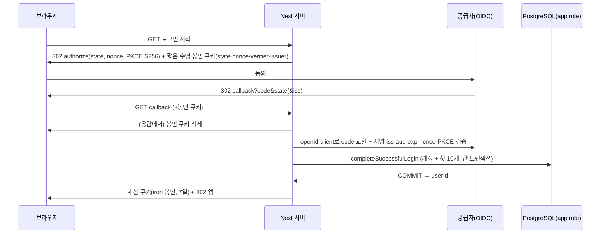

# PLAN — F4 인증·세션·첫 로그인 지급 연결 (R1)

- **상태:**
  - 공급자는 **사용자 선택 대기**다.
  - 기술 기본값은 **메인이 수락**했다(2026-11-03).
  - 이 문서는 **검토 중**이다.
  - F4 착수 승인이나 실제 인증 완료 문서가 아니다. 코드·의존성·SQL·환경은 바꾸지 않았다.
- **BASE:** `dev` `76a39d1e65a889a03eb1e5bd64a7e0b3ef161800`
  - F3 최종 제품 커밋 `c69384f`: 단위 103 · DB 99 · Node 24/26 prod 6 · E2E 12 · root 42.
  - BASE의 앱 CI(41549378945)와 dev 자동배포(41549378967)는 성공했고 container·HTTPS도 확인됐다. 이는 **메인이 확인**했으며 이 문서 작성자가 직접 확인한 것은 아니다.
  - 앱은 정적 dev와 별개다. 실서버 DB·OAuth·세션·화면 저장 연결은 없다.
- 근거 문서: [PLAN_mvp-foundation](PLAN_mvp-foundation.md) F4·G4, [PLAN_mvp-domain-storage](PLAN_mvp-domain-storage.md) §1·§2, [DATA_CONTRACT](../product/DATA_CONTRACT.md), [00_TECH_STACK_DECISION](../product/00_TECH_STACK_DECISION.md) §5, [03_MVP](../product/03_MVP.md), [PRD](../PRD.md).
- R1은 PR27 독립 검토의 P1 3건과 P2 9건을 반영했다(§12).
- 표기:
  - **[확정]** 사용자 확정
  - **[메인]** 메인 기술 기본값(사용자 선택 아님)
  - **[사실]** 코드·공식 문서로 확인
  - **[추론]** 작성자 판단
  - **[미정]** 결정 필요
  - **[미확인]** 확인하지 못함

## 0. 결정 상태

| 구분 | 내용 |
|---|---|
| [확정] 사용자 | 전체 스택(Next.js·PostgreSQL·이미지 저장소·Konva), D 테마, 감정덩어리는 **계정당 첫 성공 로그인에 10개 한 번** |
| [메인] 기술 기본값 | OIDC 검증 `openid-client` 6.8.9, 세션 S1 `iron-session` 9.0.1 봉인, 절대 7일 만료, Next 내장 `server-only`, POST 요청의 명시 Origin 검사, 첫 성공 로그인 = 공급자 검증 + F3 COMMIT, scope `openid`만, 토큰·email 저장 안 함 |
| [미정] 사용자 | **공급자(Google / Kakao / 둘 다)**. 무응답과 첫 선택지는 승인이 아니다. 여러 공급자 계정 연결, 사진·공유·AI, 탈퇴 |
| [미정] 메인(조건부) | 서버 측 state 일회 소비 저장소(§3), S2 DB 세션 전환(§5) |
| [미확인] | 선택 패키지와 Next 16.4.3·React 19.3.1·Node 24.22.2/26.13.0의 실제 호환(격리 bootstrap·CI build 전), Kakao 인가 요청이 `code_challenge`를 실제로 받는지 |

## 1. 현재 코드 사실 (BASE)

- `server/account/login.ts`
  - `completeSuccessfulLogin(db, { provider, subject })` → `Result<{ userId, createdUser, granted, balance }, "invalid_identity">`.
  - user·identity·계정·원장·잔액·`first_login_at`을 한 트랜잭션에서 처리하고, 생성 경합이면 한 번 재시도한다.
  - `provider`는 `^[a-z][a-z0-9_-]{0,31}$`이므로 `google`·`kakao`가 맞는다.
- 스키마(F2 계약):
  - `pod.users`에 email 열이 없다. 세션 테이블도 없다.
  - app role의 `auth_identities` 권한은 `SELECT, INSERT`다.
  - `server/db/migrate.ts`의 `USER_DATA_TABLES`가 down 보호 목록이다.
- `server/db/pool.ts`의 `getAppDb()`는 `POD_DATABASE_URL`만 읽는다. 로그인 계열 서버 모듈만 이 파일을 import한다.
  - F2 migration CLI(`db/migrate-cli.ts`→`migrate.ts`→`sql-policy.ts`)는 순수 Node로 실행되며 `pool.ts`를 쓰지 않는다.
  - `next.config.ts`는 `server/runtime-mode.ts`를 import한다.
- `server/context.ts`의 `getDiaryContext()`는 로컬 fixture(개발·시험 전용, 운영 거부)가 아니면 `unavailable`이다.
- ESLint는 `ui/**`·`shared/**`에서 server를 직접 import하지 못하게 막는다. 전이 import는 보장하지 않는다.

## 2. 공급자 중립 흐름과 첫 성공 로그인



- **신뢰 경계:** userId는 서버가 봉인을 검증한 세션에서만 얻는다. 클라이언트의 form·URL·헤더 값과 identity는 신뢰하지 않는다. `completeSuccessfulLogin`은 프로토콜 검증이 성공한 뒤에만 호출한다.
- **subject:** ID 토큰의 `sub`를 쓴다. Google은 public `sub`, Kakao는 회원번호이며 pairwise다(§4). email과 닉네임은 식별이나 연결에 쓰지 않는다.
- **[메인] 첫 성공 로그인 = 공급자 검증 성공 + F3 COMMIT 성공.**
  - 세션 쿠키 응답은 DB와 원자적이지 않다. 그래서 쿠키 발급이 실패해도 지급은 남고, 재시도는 F3 멱등성 때문에 같은 userId·`granted=false`가 된다.

## 3. 로그인 진행 상태(state·nonce·verifier)와 재생

**[메인] 현재 설계:**
- 상태는 짧은 수명(예: 10분)의 브라우저 결합 iron 봉인 쿠키에 둔다.
- callback 응답에서 그 쿠키를 지운다.
- 공급자 code는 한 번만 쓸 수 있다.
- 계정·지급은 F3 멱등성에 맡긴다.
- **서버 측 원자적 state 소비 저장소는 두지 않는다.**

| 상황 | 결과 | 보장 근거 |
|---|---|---|
| 쿠키가 삭제된 브라우저가 같은 callback URL을 다시 요청 | `state 없음`으로 거부, DB 변화 없음 | 브라우저 쿠키 삭제 |
| 쿠키가 지워지기 전의 동시 callback 2건, 또는 복사한 쿠키와 URL 재생 | 두 번째도 state 대조를 **통과할 수 있다**. 같은 code 재교환은 공급자가 거부할 수 있다(code 일회 사용) | 공급자 code 일회성. 앱 state 저장소가 아니다 |
| 검증된 로그인 사건이 같은 identity로 중복 도달 | 같은 userId, **지급 1회**(원장 1행·잔액 10) | F3 멱등성(유일 제약 + 행 잠금) |

- 따라서 이 문서는 "앱이 서버에서 state 재사용을 항상 거부한다"는 **보장을 하지 않는다.**
- 엄격한 서버 측 일회 소비가 필요하면 별도의 메인 결정이 필요하다. 소비 기록 표(`INSERT … ON CONFLICT DO NOTHING`, 짧은 TTL)를 두는 것이고, F2 계약과 migration 변경이 따른다(§5 S2와 같은 절차).

## 4. 보안 요건

출처는 §11.

- **프로토콜 검증은 `openid-client`가 한다** [메인]: discovery, 서명·`iss`·`aud`·`exp`·`nonce`·PKCE. 앱은 JWT를 직접 파싱하거나 검증하지 않는다.
  - mix-up 방어: 요청 시 issuer를 봉인 쿠키에 함께 저장하고, issuer는 고정 허용 목록의 공식 값만 쓴다.
- **PKCE S256**(RFC 9700):
  - Google: discovery가 `plain`·`S256`을 광고한다.
  - Kakao: discovery가 `["S256"]`를 광고하지만, REST 인가 요청 매개변수 표에는 `code_challenge`가 없다. 실제 앱 인가 요청에서 받아들이는지는 **미검증**이다.
  - **받아들이지 않으면 PKCE를 조용히 끄지 않는다.** Kakao 착수 전에 메인이 근거를 갖고 호환 방식을 결정한다(§9 성공 기준과 같은 조건).
- **Kakao 설정 조건** [사실]:
  - discovery `subject_types_supported: ["pairwise"]`, `token_endpoint_auth_methods_supported: ["client_secret_post"]`, `issuer: https://kauth.kakao.com`.
  - pairwise이므로 **앱마다 `sub`가 다르다.** 운영 Kakao 앱은 안정적으로 유지한다.
  - 앱을 바꾸면 기존 사용자를 자동으로 같은 사람으로 매핑할 수 없다. 이관하려면 별도 설계가 필요하다(불가능이라는 단정은 아님).
  - dev와 운영 앱을 분리하면 dev와 운영의 계정이 서로 다르다.
- **scope·저장 [메인]:**
  - `openid`만 요청한다.
  - 공급자 access/refresh/ID 토큰과 email을 저장하지 않는다.
  - 로그에 code·토큰·쿠키 값을 남기지 않는다.
- **redirect:** 환경별 정확한 문자열을 등록한다. 로그인 뒤 이동 경로는 앱 내부 상대 경로 허용 목록만 받는다(open redirect 방지).
- **쿠키 [메인]:**
  - `__Host-` 접두, `HttpOnly`, `Secure`, `SameSite=Lax`(OAuth 복귀가 최상위 GET이므로), `Path=/`, 만료 명시.
  - 로컬 http는 development·test에서만 `Secure=false`를 허용하고 운영에서는 거부한다.
- **상태 변경 요청 CSRF [메인]**(P1-2):
  - 로그아웃 등 상태를 바꾸는 요청은 POST + 서버 세션 검증 + **Origin을 설정된 앱 origin과 명시적으로 대조**한다. Origin이 없거나 다르면 거부한다.
  - 기준 origin은 신뢰된 설정 `POD_AUTH_BASE_URL`에서 온다. 요청의 Host나 forwarded 헤더만으로 기준을 만들지 않는다.
  - 커스텀 route handler에 Server Actions의 자동 Origin 검사가 있다고 가정하지 않는다.
  - Server Actions는 내장 Origin·Host(또는 `X-Forwarded-Host`) 대조(Next data-security)를 유지하고, 그 안에서 DAL로 다시 인증한다.
  - `SameSite=Lax`는 same-site의 다른 origin(dev와 운영 서브도메인)을 막지 못한다 [추론]. 그래서 명시 Origin 검사가 필요하다.
  - OAuth callback GET은 state·PKCE·nonce·토큰 검증으로 지키는 별도 흐름이며, 이 POST 규칙과 구분한다.
  - F6: 신뢰된 프록시·forwarded host 검증을 붙인다. CI: 다른 origin, Origin 누락, same-site 다른 origin을 거부하는지 시험한다.
- **자동 계정 연결:** email 기반 자동 연결은 구현하지 않는다(권고 유지). 여러 공급자를 고르면 계정 연결 정책은 별도 [미정]이다.

## 5. 세션

**[메인] S1 = `iron-session` 봉인 쿠키**
- payload는 `{ v: 1, userId, iat, exp }`만 담는다. 프로필·기록·원장·공급자 토큰은 넣지 않는다.
- **절대 7일**이다. iron `ttl`을 7일로 두고 payload `exp`도 확인한다. 사용해도 연장하지 않으며, 재인증하면 새로 7일이다.
- 로그아웃은 브라우저 쿠키 삭제다. **이미 복사된 쿠키를 서버에서 따로 폐기하는 것은 보장하지 않는다.**
- 키 회전: iron의 번호 붙은 비밀 키 맵으로 새 키와 이전 키를 함께 허용하고, 가장 큰 번호로 새로 봉인한다. 그래서 회전이 곧 전원 로그아웃을 뜻하지는 않는다.
- 참고: Next 인증 가이드의 jose `SignJWT` HS256 예시는 서명이지 암호화가 아니다. 이 계획의 S1은 iron 봉인이다.

**S2 DB 세션(미채택 대안)** — 기기별 폐기나 서버 측 즉시 무효화가 필요해지면 그때 채택한다. 영향 범위:
- 새 migration `0002_auth_sessions`: `id uuid PK DEFAULT uuidv7()`, `user_id` FK→`pod.users` ON DELETE CASCADE, `token_hash char(64) UNIQUE`, `created_at`, `expires_at`, 인덱스 `(user_id)`, app 권한 `SELECT, INSERT, DELETE`.
- 함께 고칠 곳:
  - `server/db/migrate.ts`의 `USER_DATA_TABLES`
  - 새 down 파일의 사용자 데이터 가드
  - `tests/db/f2-support.ts`의 `USER_DATA_TABLES`
  - migrate·privileges 회귀 시험
  - DATA_CONTRACT §4~§6
- 롤백 순서: 앱이 세션 표를 쓰지 않도록 먼저 되돌린다(expand 상태 유지). down은 빈 CI DB에서만 한다.

## 6. 서버 전이 import 경계 (F4 실제 HTTP 연결 전 필수 완료 조건, P1-3)

- **[메인] 민감한 auth·session·DAL 모듈과 그 모듈이 호출하는 서버 모듈 경계에 `import 'server-only'`를 둔다.**
  - Next가 내부에서 처리한다(data-security). 클라이언트 쪽에서 직접이든 전이로든 import하면 빌드 오류가 난다.
  - 사용자 허락 게이트가 아니다.
  - npm `server-only` 설치는 Next에서 선택 사항이다. 시험·TypeScript·ESLint 해석에 필요하면 메인의 구현 bootstrap에서 판단한다.
- **넣지 않는 곳:** 순수 Node로 실행되는 F2 migration CLI 경로(`db/migrate-cli.ts`·`migrate.ts`·`sql-policy.ts`)와 `next.config.ts`가 import하는 `runtime-mode.ts`.
  - [추론] 이 경로들은 Next 번들러를 거치지 않으므로 marker가 실행 오류를 낼 수 있다. 실제 모듈 그래프로 확인한 뒤 경계를 정한다.
- **Vitest:** unit·db 시험에서 `server-only`를 해석하는 방법(조건 또는 alias)은 **시험 설정 파일에만** 둔다. 시험용 no-op alias가 제품 `next build`에 적용되면 안 된다.
- **검증:** 격리 CI에서 시험 전용 client 컴포넌트가 auth 모듈을 직접 import할 때와 shared를 거쳐 전이로 import할 때 모두 `next build`가 실패하는지 확인한다. fixture는 제품 경로 밖의 임시 빌드 디렉터리에 둔다.

## 7. 비밀값·환경·콘솔 (이름만)

- 키 이름:
  - `POD_AUTH_SESSION_SECRETS`(iron 키 맵, 각 32자 이상)
  - `POD_AUTH_BASE_URL`
  - 고른 공급자 것만: `POD_AUTH_GOOGLE_CLIENT_ID`·`_SECRET`, `POD_AUTH_KAKAO_CLIENT_ID`·`_SECRET`
- 값이 없으면 **fail closed**다. 로그인·세션 경로는 "사용 불가"로 응답한다. dummy 비밀로 인증되는 fallback은 없다. 빌드는 비밀 없이도 성공해야 한다(요청 시점에 검사).
- 실제 값은 Cloud·PR CI에 주지 않는다. 시험은 가짜 키(`ci-only-*`)와 모의 issuer만 쓴다. 환경별 프로비저닝은 F6에서 메인이 비공개 런북으로 한다.
- 공급자가 정해진 뒤 메인이 안내할 콘솔 작업(지금 실행하지 않음):
  - Google: 동의 화면, 웹 클라이언트, 환경별 redirect URI, scope `openid`.
  - Kakao: 앱, 웹 도메인, Redirect URI, OIDC 활성화, 최소 동의항목, client secret, PKCE 수락 확인, 운영 앱 고정.

## 8. 분할 계획

### F4a — 세션 codec·설정·쿠키 정책·서버 경계 (공급자 무관)

- 범위:
  - `iron-session` 호환 bootstrap(격리 설치·`npm ls`·build·Node 24/26) → RED → 독립 runner → GREEN.
  - **이 문서의 기술 결정과 계약이 독립 검토에서 수락된 뒤에 코드를 쓴다.**
- 이 단계에서 하지 않는 것:
  - 실제 OAuth route, 세션으로 인증된 `getDiaryContext` 분기, 로그인 화면.
  - 기존 fixture·`unavailable` 경계와 F2 CLI는 그대로 둔다. `openid-client`는 설치하지 않는다.
- 공개 계약 초안(검토 대상이며 확정 아님). 파일 `app/src/server/auth/session.ts`(`server-only`).

  ```ts
  type SessionConfig = { secrets: Record<number, string>; baseUrl: URL; secureCookies: boolean; now: () => Date };
  loadSessionConfig(env: Record<string, string | undefined>, nodeEnv: string): Result<SessionConfig, "auth_not_configured" | "invalid_config">;
  sealSession(cfg: SessionConfig, userId: string): Promise<{ value: string; expiresAt: Date }>;   // userId UUID가 아니면 throw
  readSession(cfg: SessionConfig, sealed: string | undefined): Promise<Result<{ userId: string; expiresAt: Date }, "missing" | "invalid" | "expired">>;
  sessionCookieOptions(cfg: SessionConfig, expiresAt: Date): { name: "__Host-pod_session"; httpOnly: true; secure: boolean; sameSite: "lax"; path: "/"; expires: Date };
  assertSameOrigin(cfg: SessionConfig, originHeader: string | null): Result<null, "origin_missing" | "origin_mismatch">;
  ```

  - `invalid_config`: 키가 32자 미만이거나 번호가 아님, URL이 https가 아님(development·test의 localhost 제외), 운영에서 `secureCookies=false`.
  - `readSession`의 `invalid`: 변조, 다른 키, 형식 오류, `v` 불일치, userId가 UUID가 아님.
- 시험(RED 대상):
  - 단위: 봉인→열기 왕복, 7일 경계(`exp-1ms` 통과·`exp` 거부, 주입한 시계), 변조·잘린 값·다른 키 거부, 이전 키로 봉인한 값을 키 맵으로 열기, 비UUID 거부, 미설정 → `auth_not_configured`, 운영 + http·loopback 거부, Origin 누락·불일치·same-site 다른 origin 거부, 쿠키 속성.
  - 빌드 경계(격리 CI): §6의 직접·전이 import에서 `next build` 실패.
  - 회귀: 단위 103·DB 99·prod 6·E2E 12·root 42 유지. 신규 시험 수는 잠그지 않는다.

### F4b/c — OIDC callback + F3 지급 + 세션 문맥·route·UI (사용자가 공급자를 고른 뒤)

- 같은 기능 범위에서 연결해 실제 로그인과 지급이 함께 켜지게 한다.
- `openid-client`는 이 시점에 설치한다. 승인되지 않은 공급자를 기본값으로 켜지 않는다. 고른 공급자만 허용 목록에 넣는다.
- 시작·callback route → `completeSuccessfulLogin` → `sealSession` → 쿠키. `getDiaryContext`에 세션 분기를 추가하고, POST 로그아웃(Origin 검사)과 D 스타일 로그인·안내 화면을 만든다.
- 시험:
  - 단위·DB: §3 표의 세 가지 사례, 지급 1회와 `SUM(delta)=balance`, 세션 → 소유자 조건 조회.
  - **격리 CI Playwright + 127.0.0.1 모의 OIDC issuer**(시험 코드가 discovery·JWKS·token을 흉내냄): 성공, 취소, state·서명·iss·aud·nonce 위조, 같은 code 중복, 쿠키 삭제 뒤 재요청.
  - 운영 빌드·실행이 모의·http issuer를 거부하는지.
  - 로그인 우회나 시험용 backdoor는 제품에 만들지 않는다.
- 명령은 일회용 PG·격리 CI·개발 PC에서만 실행한다: `npm --prefix app test`, `run test:db`, `run test:e2e`. 공유 운영 서버에서 Next·FullCheck·E2E를 실행하지 않는다.
- 롤백: 인증 env를 제거하면 `unavailable`로 돌아간다. 정적 dev와 운영에는 영향이 없다. 이미 지급된 원장은 되돌리지 않는다.

## 9. 사용자 선택과 무관한 요구·성공 기준

1. 서버가 검증한 공급자 사건만 계정을 만들고, 계정당 10개를 정확히 한 번 지급한다. 중복 도달해도 1회다.
2. 기록·설정의 userId는 서버가 검증한 세션에서만 온다. 세션이 없으면 로그인 안내를 보인다.
3. §3 표의 각 상황이 표와 같다. 앱 서버 state 재사용 거부는 보장하지 않는다.
4. PKCE S256·state·nonce·issuer·redirect를 검증한다. **공급자가 PKCE를 받아들이지 않는 것으로 확인되면** 착수 전에 메인의 호환 결정을 받는다(조용히 끄지 않음).
5. 상태 변경 POST는 명시 Origin 검사를 통과해야 한다. 세션은 절대 7일이다.
6. 공급자 토큰과 email을 저장하지 않는다. 세션에 개인 기록을 넣지 않는다.
7. 운영은 모의 issuer·fixture·http 쿠키·미설정 비밀 fallback을 거부한다.
8. auth·DAL 모듈을 client에서 전이로 import하면 `next build`가 실패한다.

## 10. 인증 라이브러리 비교 (채택: C)

npm과 공식 문서는 2026-11-03에 확인했다. 설치·clone·실행은 하지 않았다.

| 항목 | A Auth.js(`next-auth`) | B Better Auth | **C `openid-client` + `iron-session` [메인 채택]** |
|---|---|---|---|
| 상태 | v5 `5.0.0-beta.32` 베타, 안정판은 v4 `4.24.15`. 둘 다 2026-07-20 이후 새 릴리스 없음. 공식 사이트 배너 "The Auth.js project is now part of Better Auth." | 1.7.15(2026-11-01) | 6.8.9 / 9.0.1 |
| 세션 | adapter가 없으면 JWT 기본 | DB 세션 기본(user·session·account·verification 테이블) | S1 iron 봉인 |
| 스키마 | JWT 전략이면 없음 | 자체 user·account가 `pod.users`·`auth_identities`와 중복 | 없음(S1) |
| F3 연결 | 콜백 연결은 가능해 보이나 세부 [미확인] | [사실] `after` hook은 COMMIT 뒤. [추론] 중복 모델 매핑과 원자성 연결 비용이 커서 미채택. Kakao 기본 scope가 `account_email`·`profile_*`이므로 `openid`만 쓰려면 override 필요 | 콜백이 직접 호출 |
| 미채택 이유 | 베타 유지 상태와 프로젝트 편입에 따른 장기 경로 불확실 [추론] | 위 비용 [추론] | — |

- A·B가 이 구조에서 **불가능하다는 뜻은 아니다.**
- 제외: Arctic(공식 사이트 "deprecated in July 2026", npm 지원 중단 표시), 외부 인증 서비스(사용자가 정하지 않은 외부 전송).
- C는 보안 흐름의 조립 범위가 넓다. 그래서 프로토콜 검증은 `openid-client`에, 봉인은 `iron-session`에 맡긴다는 조건으로 채택했다.

## 11. 출처 (1차, 2026-11-03 HTTP 확인)

- Next.js:
  - https://nextjs.org/docs/app/guides/authentication (lastUpdated 2026-09-16)
  - https://nextjs.org/docs/app/guides/data-security (2026-10-06: Server Actions Origin↔Host/`X-Forwarded-Host` 대조, `allowedOrigins`, `server-only` 내장 처리·설치 선택)
- 선택 패키지:
  - npm `openid-client/6.8.9`, `iron-session/9.0.1`, `server-only/0.0.1`(exports `react-server`→`empty.js`, `default`→`index.js`)
  - https://github.com/panva/openid-client
  - https://github.com/vvo/iron-session (`sealData`/`unsealData`, 번호 붙은 키 맵, 32자 이상, `ttl` 기본 14일, Next `cookies()` 사용)
- Discovery:
  - https://kauth.kakao.com/.well-known/openid-configuration (S256, pairwise, `client_secret_post`, RS256)
  - https://accounts.google.com/.well-known/openid-configuration
- Google·Kakao 문서:
  - https://developers.google.com/identity/openid-connect/openid-connect
  - https://developers.kakao.com/docs/ko/kakaologin/common
  - https://developers.kakao.com/docs/ko/kakaologin/rest-api
- 비교 대상:
  - Auth.js: https://authjs.dev/ (편입 배너), `/getting-started/installation`, `/getting-started/migrating-to-v5`, `/concepts/session-strategies`, `/getting-started/providers/kakao`
  - Better Auth: https://www.better-auth.com/docs/concepts/database , `/concepts/session-management`, `/concepts/users-accounts`, `/authentication/kakao`
  - Arctic: https://arctic.pilcrowonpaper.com/
- RFC 9700: https://www.rfc-editor.org/rfc/rfc9700.html

## 12. PR27 검토 반영 대조

| 항목 | 해소 |
|---|---|
| P1-1 state 재생 | §3. 쿠키 삭제·공급자 code 일회성·F3 멱등을 나누고, 서버 state 재사용 거부를 보장하지 않는다고 명시. 엄격 소비가 필요하면 별도 결정 |
| P1-2 route handler CSRF | §4. POST + 세션 + 설정 origin 명시 대조, Server Actions 내장 검사 유지, F6 프록시·CI 거부 시험 |
| P1-3 `server-only` | §6. Next 내장 처리를 메인 기술 기본값으로 채택, F4 HTTP 연결 전 필수 완료 조건, Vitest는 시험 설정에 격리, F2 CLI 제외 |
| P2-1·2 Kakao | §4·§9. S256 광고와 실제 수락 미검증 구분, PKCE를 조용히 끄지 않음. pairwise·`client_secret_post`·운영 앱 고정 |
| P2-3·4·5 비교 | §10. 사실과 추론 분리, Better Auth scope override, Auth.js 편입·베타 상태, C 조건 |
| P2-6 S1 | §5. 절대 7일·연장 없음, 키 맵 회전, 복사된 쿠키 폐기 미보장 |
| P2-7 E2E | §8 F4b/c. Playwright + 모의 issuer, 운영 거부 |
| P2-8 S2 영향 | §5. `USER_DATA_TABLES`·down 가드·`f2-support`·회귀·롤백 순서 |
