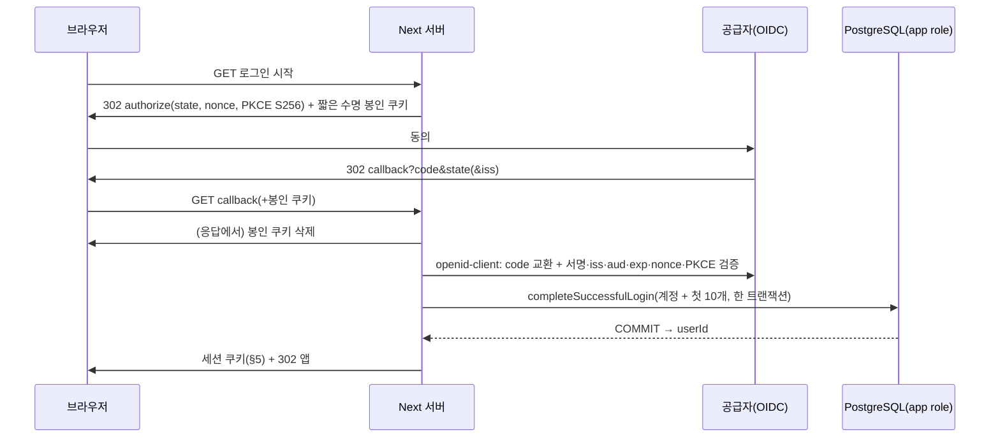

# PLAN — F4 인증·세션·첫 로그인 지급 연결 (R4)

- 상태:
  - **2026-11-03 사용자 확정:** 로그인 공급자는 **Google·Kakao 둘 다**, 계정 탈퇴는 **30일 복구 기간 뒤 삭제**다([PRD](../PRD.md) §0, 탈퇴 설계는 [PLAN_account-lifecycle](PLAN_account-lifecycle.md)).
  - 공급자 간 계정 연결은 **사용자 답변 대기**다.
  - 세션 `gen`(키 5개)과 DAL 매 요청 검사는 **메인이 채택**했다(R4, 2026-11-03, 사용자 선택 아님).
  - 기술 기본값은 **메인이 수락**했다(R1·R2·R4, 2026-11-03).
  - R4 설계는 **독립 검토 후 메인이 수락**했다(2026-11-03, P0·P1 없음). 복구 TTL·DB generation 비교의 비차단 P2도 계약에 반영했다.
  - 실제 인증 완료 문서는 아니다. 계획 PR은 코드·의존성·SQL·환경을 바꾸지 않았으며, 패키지 준비 결과는 아래에 구분한다.
  - **F4a 완료(2026-11-03):** 세션 codec·서버 전용 경계를 구현·독립 검증했다(§13). 실제 OAuth·DAL·탈퇴·복구·삭제는 후속이다.
- BASE: `dev` `76a39d1e65a889a03eb1e5bd64a7e0b3ef161800`.
  - F3 최종 `c69384f` 기준선: 단위 103 · DB 99 · Node 24/26 prod 6 · E2E 12 · root 42.
  - BASE의 앱 CI(41549378945), dev 자동배포(41549378967), container·HTTPS는 **메인이 확인**했다(작성자가 직접 확인한 것 아님).
  - 앱은 정적 dev와 별개다. 실서버 DB·OAuth·세션·화면 저장 연결은 없다.
- 근거: [PLAN_mvp-foundation](PLAN_mvp-foundation.md) F4·G4, [PLAN_mvp-domain-storage](PLAN_mvp-domain-storage.md) §1·§2, [DATA_CONTRACT](../product/DATA_CONTRACT.md), [00_TECH_STACK_DECISION](../product/00_TECH_STACK_DECISION.md) §5, [03_MVP](../product/03_MVP.md), [PRD](../PRD.md).
  - PR27 독립 검토 R0·R1과 iron 호환 spike 결과를 반영했다(§12).
- 표기:
  - **[확정]** 사용자 확정
  - **[메인]** 메인 기술 기본값(사용자 선택 아님)
  - **[사실]** 코드·공식 원문·spike 실증
  - **[추론]** 작성자 판단
  - **[미정]** 결정 필요
  - **[미확인]** 확인하지 못함

## 0. 결정 상태

| 구분 | 내용 |
|---|---|
| [확정] 사용자 | 전체 스택, D 테마, 감정덩어리 **계정당 첫 성공 로그인 10개 한 번**, **Google·Kakao 로그인 둘 다**, **탈퇴 → 30일 복구 → 삭제**(2026-11-03) |
| [메인] | OIDC 검증 `openid-client` 6.8.9, 세션 S1 `iron-session` 9.0.1 봉인, 절대 7일, Next 내장 `server-only`, POST 요청의 명시 Origin 검사, 첫 성공 로그인 = 공급자 검증 + F3 COMMIT, scope `openid`만, 토큰·email 저장 안 함 |
| [메인] R2 | §5 설정 계약, 쿠키 이름 분기, `readSession` 분류, payload 시간 규칙, Origin 정확 대조, F4a 파일·단계 소유 |
| [미정] 사용자 | **공급자 간 계정 연결**(권고 후보: 로그인 뒤 다른 수단 연결 / 대안: 공급자별 별도 계정, email 자동 연결·기록·잔액 병합은 미승인), 사진·공유·AI |
| [메인] R4 | 세션 `gen` 키 5개 계약(§5.1·§5.3), DAL 매 요청 `status`·`gen` 검사(§5.4), F3 `LoginOutcome` kind union 확장과 복구 쿠키 계약([PLAN_account-lifecycle](PLAN_account-lifecycle.md) §3). 구현 착수·완료를 뜻하지 않는다 |
| [미정] 메인(조건부) | 서버 측 state 소비 저장소(§3), S2 DB 세션(§6) |
| [미확인] | 실제 인증·공급자 연동·DAL 상태/세대 대조, Kakao가 실제로 `code_challenge`를 받는지. 패키지·세션 codec은 Node 24·26 CI에서 통과했다(§13). http Secure 쿠키 수락에 의존하지 않는다 |

## 1. 현재 코드 사실 (BASE)

- **로그인 함수:** `server/account/login.ts`의 `completeSuccessfulLogin(db, { provider, subject })` → `Result<{ userId, createdUser, granted, balance }, "invalid_identity">`.
  - 한 트랜잭션에서 처리하고, 생성 경합 시 한 번 재시도한다.
  - `provider` 형식 `^[a-z][a-z0-9_-]{0,31}$`.
- **스키마:** users에 email이 없고 세션 테이블도 없다. app role은 `auth_identities`에 `SELECT, INSERT`만 갖는다. down 보호 목록은 `server/db/migrate.ts`의 `USER_DATA_TABLES`다.
- **DB 접근:** `server/db/pool.ts`는 `POD_DATABASE_URL`만 읽는다.
- **순수 Node 경로(Next 번들러를 거치지 않음):**
  - F2 CLI: `migrate-cli.ts` → `migrate.ts` → `sql-policy.ts`
  - `next.config.ts` → `runtime-mode.ts`
- **요청 문맥:** `getDiaryContext()`는 fixture(개발·시험 전용)가 아니면 `unavailable`이다.
- **E2E 환경:** `playwright.config.ts`는 `next dev -H 127.0.0.1`과 `http://127.0.0.1:<port>`를 쓴다.
- **TDD 경로:** `.claude/tdd.conf`의 `TEST_PATTERNS`는 `tests/*`, `.claude/tdd.conf`, `app/tests/*`, `app/vitest*.ts`, `app/playwright*.ts`다.

## 2. 흐름과 첫 성공 로그인



- **신뢰 경계:** userId는 서버가 봉인을 검증한 세션에서만 얻는다. 클라이언트의 form·URL·헤더 값과 identity는 신뢰하지 않는다.
- **subject:** ID 토큰의 `sub`다. Google은 public, Kakao는 회원번호이며 pairwise다. email·닉네임은 식별이나 연결에 쓰지 않는다.
- **[메인] 첫 성공 로그인 = 공급자 검증 + F3 COMMIT.**
  - 쿠키 응답은 DB와 원자적이지 않다.
  - 쿠키 발급이 실패해도 지급은 남는다. 재시도하면 같은 userId에 `granted=false`가 된다.

## 3. 로그인 진행 상태와 재생

[메인] 짧은 수명의 브라우저 결합 봉인 쿠키 + 응답에서 삭제 + 공급자 code 일회성 + F3 멱등. **서버 측 원자적 state 소비 저장소는 두지 않는다.**

| 상황 | 결과 | 근거 |
|---|---|---|
| 쿠키가 삭제된 브라우저가 같은 callback을 재요청 | `state 없음`으로 거부, DB 변화 없음 | 브라우저 쿠키 삭제 |
| 삭제 전 동시 callback, 또는 복사한 쿠키와 URL 재생 | state 대조를 **통과할 수 있다**. 같은 code 재교환은 공급자가 거부할 수 있다 | 공급자 code 일회성(앱 저장소 아님) |
| 검증된 로그인 사건이 같은 identity로 중복 도달 | 같은 userId, 지급 1회(원장 1행·잔액 10) | F3 멱등 |

- 앱 서버의 state 재사용 거부는 **보장하지 않는다.**
- 엄격한 서버 측 소비가 필요하면 메인이 따로 결정하고 F2 migration을 추가한다(§6 S2와 같은 절차).

## 4. 보안 요건

- **프로토콜 검증:** `openid-client`가 discovery, 서명·`iss`·`aud`·`exp`·`nonce`·PKCE를 검증한다. 앱이 JWT를 직접 파싱하지 않는다. issuer는 허용 목록 값만 쓰고, 요청 시 봉인해 mix-up을 막는다.
- **PKCE S256:**
  - Google discovery는 `plain`·`S256`을 광고한다.
  - Kakao discovery는 `["S256"]`를 광고하지만, REST 인가 매개변수 표에는 `code_challenge`가 없다. 실제로 받는지는 **미검증**이다.
  - **조용히 끄지 않는다.** 받지 않으면 Kakao 착수 전에 메인이 근거를 갖고 결정한다.
- **Kakao 설정 조건:** `pairwise` `sub`(앱마다 다름), `client_secret_post`, issuer `https://kauth.kakao.com`.
  - 운영 앱을 고정한다. 앱을 바꾸면 자동 동일인 매핑이 안 되므로 별도 이관 설계가 필요하다(불가 단정은 아님).
  - dev와 운영 앱을 분리하면 계정도 분리된다.
- **수집·저장:** scope는 `openid`만 쓴다. 공급자 토큰·email은 저장하지 않는다. code·토큰·쿠키·키 값은 로그에 남기지 않는다.
- **redirect:** 환경별 정확한 문자열을 쓴다. 로그인 뒤 이동은 내부 상대 경로 허용 목록만 받는다.
- **CSRF:**
  - 상태를 바꾸는 POST는 서버 세션 확인 + `assertSameOrigin`(§5)을 거친다.
  - route handler에 자동 Origin 검사가 있다고 가정하지 않는다.
  - Server Actions는 내장 Origin·Host(`X-Forwarded-Host`) 대조(Next data-security)와 DAL 재인증을 유지한다.
  - `SameSite=Lax`는 same-site의 다른 origin을 막지 못한다 [추론]. 그래서 명시 대조가 필요하다.
  - OAuth callback GET은 별도 흐름(state·PKCE·nonce·토큰 검증)이다.
  - F6에서 신뢰된 프록시·forwarded host를 검증한다.
- **계정 연결:** email 기반 자동 연결은 구현하지 않는다. 공급자를 여러 개 쓸 때의 연결 정책은 [미정]이다.

## 5. F4a 세션 계약 [메인 R2]

파일 `app/src/server/auth/session.ts`(`import 'server-only'`). 클라이언트가 `SessionConfig`를 만드는 경로는 없다. 아래 helper는 `loadSessionConfig`가 검증한 cfg만 받는다.

### 5.1 타입

```ts
type SessionConfig = Readonly<{
  secrets: Readonly<Record<number, string>>;   // 번호 → 키(원문 그대로)
  baseUrl: URL;                                 // new URL(parsed.origin)
  secureCookies: boolean;                       // baseUrl.protocol에서 파생
  now: () => Date;                              // 기본 () => new Date()
}>;
type SessionPayload = { v: 1; userId: string; gen: number; iat: number; exp: number }; // 키 정확히 5개. gen: Number.isSafeInteger && > 0. iat·exp: epoch ms

loadSessionConfig(env: Record<string, string | undefined>, nodeEnv: string | undefined):
  Result<SessionConfig, "auth_not_configured" | "invalid_config">;
sealSession(cfg: SessionConfig, subject: { userId: string; gen: number }): Promise<{ value: string; expiresAt: Date }>;
readSession(cfg: SessionConfig, sealed: string | undefined):
  Promise<Result<{ userId: string; gen: number; expiresAt: Date }, "missing" | "invalid" | "expired">>;
sessionCookieOptions(cfg: SessionConfig, expiresAt: Date): {
  name: "__Host-pod_session" | "pod_session"; httpOnly: true; secure: boolean;
  sameSite: "lax"; path: "/"; expires: Date };          // Domain 속성 없음
assertSameOrigin(cfg: SessionConfig, origin: string | null): Result<null, "origin_missing" | "origin_mismatch">;
```

- 시계 주입: 호출자는 검증된 cfg를 복사한 새 객체에서 `now`만 바꿔 넘길 수 있다(`{ ...cfg, now }`).
- 패키지 준비 완료: PR28 `7004e8a`와 [CI 41656725705](https://github.com/kindsr/devscent-pieceofdays-main/actions/runs/41656725705)에서 Node 24.22.2·26.13.0 설치·앱 회귀를 검증했다. 이 결과는 신규 세션 API의 동작 검증과 구분한다.
- 제품 코드는 전역 시계나 환경 변수를 바꾸지 않는다.
- `cfg.now`는 유효한 `Date`를 돌려주는 내부 DI 계약이다.

### 5.2 `loadSessionConfig` 판정 (위에서부터)

| 순서 | 조건 | 결과 |
|---|---|---|
| 1 | `POD_AUTH_SESSION_SECRETS` 또는 `POD_AUTH_BASE_URL`이 없거나 trim 후 빈 문자열 | `auth_not_configured`(fallback 없음) |
| 2 | SECRETS가 JSON object가 아님(파싱 실패·array·null·원시값) 또는 빈 객체 | `invalid_config` |
| 3 | key가 선행 0 없는 양의 10진 정수 문자열(`^[1-9][0-9]*$`)이 아니거나 `Number.isSafeInteger`를 벗어남(0·음수·소수·지수·문자 키) | `invalid_config` |
| 4 | value가 string이 아니거나, `.length`(UTF-16 code unit) < 32이거나, 공백만 있음. 값은 trim·변형하지 않는다 | `invalid_config` |
| 5 | BASE_URL이 WHATWG `new URL` 파싱 실패, 또는 protocol이 `http:`·`https:`가 아님 | `invalid_config` |
| 6 | username·password가 있거나, pathname이 `/`가 아니거나, search·hash가 비어 있지 않음(루트의 끝 슬래시는 허용) | `invalid_config` |
| 7 | 개발 http 예외: `nodeEnv`가 **정확히** `development`·`test`이고 `protocol=http:`이고 정규화된 `hostname`이 `localhost`·`127.0.0.1`·`[::1]` 중 하나 | 허용 → `secureCookies=false` |
| 8 | 그 밖의 경우(nodeEnv가 빈 값·기타면 운영 규칙): `https:`가 아니거나, hostname이 `localhost`·IPv4 `127.0.0.0/8`·IPv6 `[::1]`이면 거부. 개발이라도 7번 집합 밖의 http 호스트는 거부 | `invalid_config` |
| 9 | 통과 | `ok`: `baseUrl = new URL(parsed.origin)`, `secureCookies = (protocol === "https:")`, `now = () => new Date()` |

- DNS 조회는 하지 않는다. 비표준 IPv4 표기(예: `127.1`, `0x7f.0.0.1`)는 WHATWG 정규화 결과로 판정한다. 기본 포트와 대소문자도 URL 정규화를 따른다.
- 외부 env로 `secure`를 따로 켜고 끄는 토글은 받지 않는다.
- 실제 운영 키는 F6에서 충분히 무작위로 생성한다. 값을 문서·로그에 쓰지 않는다.

### 5.3 봉인·읽기·쿠키·Origin

| 함수 | 계약 |
|---|---|
| `sealSession` | `userId`가 UUID가 아니거나 `gen`이 `Number.isSafeInteger(gen) && gen > 0`이 아니면 throw(메시지는 계약이 아님). payload `{ v: 1, userId, gen, iat, exp }`. `now = cfg.now()`, `iat = now.getTime()`, `exp = iat + 604_800_000`(정확히 7일), iron `sealData(payload, { password: cfg.secrets, ttl: 604_800 })`, `expiresAt = new Date(exp)`. **`ttl: 0`으로 봉인하지 않는다.** 발급 수명은 항상 정확히 7일이다 |
| `readSession` 순서 | ① `sealed === undefined` 또는 `""` → `missing`(unseal 호출 전). 공백 문자열이나 깨진 값은 ②로 간다. ② `unsealData(sealed, { password: cfg.secrets })`. 반환이 `{}`이거나 실패 → `invalid`. ③ payload 검사: 객체, 정확히 키 5개(`v`·`userId`·`gen`·`iat`·`exp`), `v === 1`, `userId` UUID, `gen`이 안전한 양의 정수, `iat`·`exp`가 안전한 비음수 정수, `exp > iat`, `exp − iat ≤ 604_800_000`, `iat ≤ cfg.now().getTime()`. 하나라도 어긋나면 `invalid`. ④ `exp ≤ cfg.now().getTime()` → `expired`, 아니면 `ok { userId, gen, expiresAt: new Date(exp) }` |
| `readSession` 원칙 | iron unseal을 통과해 기대한 payload가 나왔을 때만 인증된 값이다. `onUnsealError`의 `expired`·`unknown-password`는 HMAC 검증 **전**에도 나오므로 인증 판정이나 만료 증거로 쓰지 않는다(필요하면 민감하지 않은 reason만 관찰하고 판정과 분리한다. hook은 throw하지 않는다). raw iron TTL이 지났거나 위조된 만료 필드 때문에 `{}`가 나온 경우는 `invalid`이며 "인증된 만료"가 아니다. 더 짧은 유효 수명의 봉인은 읽을 때 허용하지만 7일 상한은 넘지 않는다 |
| 시간 기준 | 앱의 정확한 7일 기준은 payload `exp`와 `cfg.now()`다. iron의 실제 `Date.now()`와 60초 skew는 보조 만료 장치이며, 그 grace를 로그인 유효 시간에 더하지 않는다. unseal의 `ttl` 옵션으로 봉인 때 정한 TTL을 바꾼다고 가정하지 않는다 |
| `sessionCookieOptions` | `secureCookies`가 true면 `__Host-pod_session`, false면 `pod_session`. 공통: `httpOnly`, `path:"/"`, `sameSite:"lax"`, `expires`, Domain 없음. `__Host-`에 Secure가 없으면 UA가 쿠키를 버린다(RFC 6265bis)는 점이 이름을 나눈 이유다 |
| `assertSameOrigin` | `null`·`""` → `origin_missing`. 그 밖에는 `cfg.baseUrl.origin`의 직렬화 문자열과 **정확히 같을 때만** `ok`. 리터럴 `"null"`, 공백, 경로가 붙은 값, 여러 origin, 파싱 불가, port·scheme·host가 다른 값은 모두 `origin_mismatch`. 요청의 Host·forwarded 헤더로 기준을 만들지 않는다 |

- 새 오류 코드·역할·세션 정책은 추가하지 않는다.
- **R2 리뷰 P2 정리:**
  - (1) `expired`와 `invalid`는 소비자(F4b/c)가 똑같이 일반 "로그인 필요"로 처리한다. 문구·지표로 구분하는 데 쓰지 않는다. raw iron reason은 인증된 만료 근거가 아니다(실제 시계에서는 `exp` 뒤 약 60초만 `expired`가 관찰된다).
  - (2) `iat ≤ now`는 **단일 시계(단일 컨테이너)** 전제다. 인스턴스를 늘리면 F6에서 다시 판단한다.
  - (3) 요청에서 세션을 읽을 때도 `sessionCookieOptions(cfg)`의 **같은 이름 하나만** 읽는다. 다른 이름으로의 fallback은 없다(형제 도메인의 cookie tossing 방지).
  - (4) URL 범위: 개발 http 예외는 §5.2 7행뿐이다. 개발에서 `https://localhost` 같은 https loopback은 8행에 따라 거부한다. WHATWG에서 빈 `?`·`#`는 빈 search·hash라 통과하고, 결과는 origin으로 정규화된다. 그 밖의 loopback 변형(`*.localhost`·`0.0.0.0`·IPv4-mapped)은 따로 목록화하지 않는다(운영은 https와 8행 목록만으로 판정).

### 5.4 계정 상태·generation [메인 채택 R4]

- 30일 복구형 탈퇴(사용자 확정) 때문에 S1의 철회 불가 한계를 **M안**으로 보완한다(비교는 [PLAN_account-lifecycle](PLAN_account-lifecycle.md) §4).
- §5.1·§5.3의 키 5개 계약이 F4a의 단일 계약이다. F4a codec은 `gen`의 형식만 검사하고, DB 대조는 하지 않는다.
- 상태·`gen` 대조는 F4b/c DAL이 **매 요청** DB에서 한다(`status='active' AND auth_generation = gen`). 불일치·비활성·행 없음은 "로그인 필요"다.
- 대안 S2(DB 세션)는 §6(미채택).
- 복구 확인 쿠키(`purpose:"account_recovery"`, 키 6개, 10분)는 F4b/c 계약이다. F4a codec에는 구현하지 않는다(lifecycle §3).
- package-only `iron-session` bootstrap(§8 ①)은 계속 독립적으로 진행할 수 있다.
- 로그아웃은 쿠키 삭제다. 복사된 쿠키를 서버에서 따로 폐기하는 것은 보장하지 않는다. 키 회전은 번호 붙은 키 맵으로 이전 키를 함께 허용하고 가장 큰 번호로 봉인한다(spike 실증).

## 6. 세션 대안·서버 경계

**S2 DB 세션(미채택, 조건부):**
- 영향: `0002_auth_sessions`(`token_hash char(64) UNIQUE`, `user_id` FK CASCADE, `expires_at`, app 권한 `SELECT, INSERT, DELETE`), `migrate.ts`의 `USER_DATA_TABLES`, 새 down 가드, `tests/db/f2-support.ts` 목록, migrate·privileges 회귀, DATA_CONTRACT §4~§6.
- 롤백: 앱을 먼저 되돌린다. down은 빈 CI DB에서만 한다.

**server-only [메인]:**
- auth·session·DAL과 그것들이 호출하는 서버 모듈 경계에 `import 'server-only'`를 둔다.
- Next 내장으로 처리되므로 현재 tsconfig·lint에서는 패키지를 설치할 필요가 없다(spike: 미설치 상태에서 build 통과, client import 거부 확인).
  - 단, tsc가 이 모듈을 해석하지 못하므로 `noUncheckedSideEffectImports`를 켜면 다시 판단해야 한다 [미확인].
- F2 CLI 경로와 `runtime-mode.ts`에는 넣지 않는다.
- Vitest의 no-op alias는 `app/vitest*.ts`에만 두고 제품 `next build`에는 적용하지 않는다.

## 7. 비밀값·환경·콘솔 (이름만)

- 키 이름:
  - `POD_AUTH_SESSION_SECRETS`(§5.2 형식)
  - `POD_AUTH_BASE_URL`
  - 공급자(둘 다 확정): `POD_AUTH_GOOGLE_CLIENT_ID`·`_SECRET`, `POD_AUTH_KAKAO_CLIENT_ID`·`_SECRET`
- 설정이 없으면 fail closed다(로그인·세션 "사용 불가"). dummy 비밀로 인증되는 fallback은 없다. 빌드는 비밀 없이 성공하고, 검사는 요청 시점에 한다.
- 실제 값은 Cloud·PR CI에 주지 않는다. 시험은 `ci-only-*` 가짜 키와 모의 issuer만 쓴다. 환경별 프로비저닝은 F6에서 메인이 비공개 런북으로 한다.
- 공급자 콘솔 작업(메인이 사용자에게 안내, 지금 실행하지 않음):
  - Google: 동의 화면, 웹 클라이언트, 환경별 redirect, `openid`.
  - Kakao: 앱, 도메인, Redirect URI, OIDC 활성화, 최소 동의항목, client secret, PKCE 수락 확인, 운영 앱 고정.

## 8. F4a 단계·파일 소유 (경로 관문과 충돌 없게)

| 단계 | 소유 파일 | 내용·통과 조건 |
|---|---|---|
| ① 호환 bootstrap | `app/package.json`, `app/package-lock.json` | `iron-session` **9.0.1 exact 추가만**. 현재 앱 회귀와 Node 24.22.2·26.13.0 CI로 설치를 검증한다. auth 제품 코드·새 도메인 시험·실인증은 없고 `openid-client`는 설치하지 않는다. 실제 API·Node 24 호환은 GREEN에서 증명한다 |
| ② RED | `app/tests/unit/auth-session.test.ts`(기능), `app/tests/auth-build-boundary.test.mjs`(빌드 경계 harness + fixture 문자열), `app/vitest*.ts`(`server-only` no-op alias) | `TEST_PATTERNS` 안에서만 작업한다. 새 CI·workflow·package 경로는 고치지 않는다. 각 `it` 안에서 동적 import하므로, codec 모듈이 없으면 정상 RED다. 타입·설정·환경 오류는 RED가 아니다 |
| ③ GREEN | `app/src/server/auth/session.ts`와 필요한 `server-only` marker, `.github/workflows/app-validation.yml`(harness 실행 step) | RED 시험·config 수정 0. 기존 build·prod 6·E2E 12·DB 99·root 42 유지 |

**빌드 경계 harness(`node:test`):**
- 실제 auth 진입 모듈을 기반으로 다음 세 가지를 확인한다: 서버 positive control(build 성공), client 직접 import 거부, shared를 거친 전이 import 거부. 단순 모형 marker만 시험하지 않는다.
- 각각을 **격리된 임시 app 사본**에서 `next build`로 확인한다. 고정된 원본 소스는 편집하지 않는다.
- node test마다 신규 auth 모듈이 없으면 실패로 수집한다(0개·skip 없음).
- **positive control의 단계 구분(R2 P2-4):** RED의 positive control은 auth import가 **없는** 기준 사본의 build 성공이다. RED 기준선에는 존재하지 않는 auth import를 넣지 않는다. 실제 auth 모듈 기반 서버 positive control은 GREEN에서 확인한다.
- harness는 GREEN의 workflow step 전까지 CI에서 실행되지 않는다. RED 증거는 Cloud 독립 runner의 격리 실행 결과뿐이다.
- `POD_FULL_CHECK_ISOLATED=1`이 없으면 시작을 거부한다. Cloud 독립 runner와 격리 CI에서만 실행하며, 공유 운영 서버에서는 실행하지 않는다.

**기능 시험 사례 (RED 대상, 신규 시험 수는 잠그지 않음):**
- §5.2 표의 각 행: 미설정·공백, JSON 유형, key 형식(`0`·`01`·`-1`·`1.5`·`1e3`·`a`·안전 정수 초과), 31/32자·공백만, URL userinfo·path·query·hash, 개발 http 3호스트 허용, `127.1`·`0x7f.0.0.1` 정규화, 개발이라도 그 외 http 거부, 운영의 loopback·http 거부, nodeEnv 빈 값 = 운영 규칙.
- `sealSession`·`readSession`:
  - 왕복, 정확 7일(`exp−1ms` ok / `exp` expired, 주입한 시계)
  - 미래 `iat`·수명 7일 초과·키 누락(`gen` 포함)·추가 키·`v`·비UUID·`gen`이 0·음수·소수·문자열·안전 정수 초과 → `invalid`
  - `sealSession`에 비UUID나 잘못된 `gen` → throw
  - 다른 키·변조·`"abc"`·공백 → `invalid`
  - `undefined`·`""` → `missing`
  - 이전 키로 봉인 → 키 맵으로 읽기 ok
- **iron 자체 TTL 경로:** 시험 child 프로세스에서 가짜 `Date.now`로 raw TTL 경과 → `invalid`. 주입 시계 시험과 분리한다.
- 쿠키 이름과 속성 분기, Origin 표의 각 사례.

## 9. 성공 기준 (공급자 무관)

1. 서버가 검증한 공급자 사건만 계정을 만들고, 계정당 10개를 정확히 한 번 지급한다. 중복 도달해도 1회다.
2. userId는 서버가 검증한 세션에서만 얻는다. 세션이 없으면 로그인 안내를 보인다.
3. §3 표대로 동작한다. 서버 state 재사용 거부는 보장하지 않는다.
4. PKCE S256·state·nonce·issuer·redirect를 검증한다. 공급자가 PKCE를 받지 않는 것으로 확인되면 착수 전에 메인이 결정한다.
5. 상태 변경 POST는 `assertSameOrigin`을 통과해야 한다. 세션은 절대 7일이다(§5).
6. 공급자 토큰·email을 저장하지 않는다. 세션 payload는 키 5개(`v`·`userId`·`gen`·`iat`·`exp`)만 담는다.
7. 운영은 모의 issuer·fixture·http·미설정 fallback을 거부한다.
8. auth 모듈을 client에서 직접 또는 전이로 import하면 `next build`가 실패한다.
9. 탈퇴 즉시 차단·30일 복구·삭제 기준은 [PLAN_account-lifecycle](PLAN_account-lifecycle.md) §7을 따른다.

## 10. F4b/c (공급자 확정: Google·Kakao. 계정 연결 답변과 lifecycle 계획 수락 뒤)

- OIDC callback + F3 지급 + 세션 문맥·route·UI를 같은 기능 범위에서 연결해, 실제 로그인과 첫 지급이 동시에 켜지게 한다.
- `openid-client`는 이 시점에 설치한다. 허용 목록은 Google·Kakao 두 개다.
- Kakao는 실제 인가 요청의 PKCE 수락을 확인하기 전에는 켜지 않는다(§4).
- 로그인 흐름에 탈퇴 상태 분기와 복구 확인 화면을 함께 넣는다([PLAN_account-lifecycle](PLAN_account-lifecycle.md) §3).
- 시험:
  - 단위·DB: §3 표의 세 사례, 지급 1회와 `SUM(delta)=balance`.
  - **격리 CI Playwright + 127.0.0.1 모의 OIDC issuer:** 성공·취소·state·서명·iss·aud·nonce 위조·같은 code 중복·쿠키 삭제 뒤 재요청, 운영의 모의·http issuer 거부. backdoor는 없다.
- 롤백: 인증 env를 제거하면 `unavailable`로 돌아간다. 정적 dev와 운영에는 영향이 없다. 지급 원장은 되돌리지 않는다.

## 11. 라이브러리 비교와 근거 (채택 C)

| 항목 | A Auth.js | B Better Auth | **C openid-client + iron-session** |
|---|---|---|---|
| 상태 | v5 `5.0.0-beta.32` 베타 / v4 `4.24.15`. 2026-07-20 이후 새 릴리스 없음. 배너 "The Auth.js project is now part of Better Auth." | 1.7.15 | 6.8.9 / 9.0.1 |
| 스키마·F3 | JWT 전략이면 스키마 없음. 콜백 세부는 [미확인] | [사실] `after` hook은 COMMIT 뒤. [추론] 자체 user·account 모델과 중복되고 원자성을 잇는 비용이 큼. Kakao 기본 scope를 쓰지 않으려면 override 필요 | 콜백이 F3를 직접 호출, S1이면 스키마 없음 |
| 미채택 | 베타·편입에 따른 장기 경로 불확실 [추론] | 위 비용 [추론] | — |

- A·B가 불가능하다는 뜻은 아니다. Arctic(deprecated)과 외부 인증 서비스는 제외했다.

**실증 (PR27 `F4_IRON_COMPAT_SPIKE_COMPLETE`, 2026-11-03, Cloud scratch 사본):**
- 환경: Node 26.13.0 / npm 11.20.0, Next 16.4.3 / React 19.3.1.
- 결과:
  - `iron-session` 9.0.1 설치(peer 없음, 새 패키지 4개), `npm ls` exit 0.
  - lint·typecheck·단위 103 통과, Turbopack `next build` 경고 0.
  - `server-only` 패키지 없이 Next 내장 처리 확인, client 직접 import는 build exit 1.
- vendor API 관찰:
  - 모든 unseal 실패와 정상 봉인한 `{}`가 똑같이 `{}`로 돌아온다.
  - `expired`·`unknown-password` reason은 HMAC 검증 전에 나온다.
  - 만료는 `Date.now`와 60초 skew로 판정한다. unseal의 `ttl` 옵션은 판정에 쓰이지 않는다.
  - 번호 키 맵은 가장 큰 번호로 봉인한다. 키가 32자 미만이면 seal은 throw, unseal은 `invalid`다. `undefined`를 넘기면 TypeError다.
- 이 사실들이 §5 정책의 근거다. **제품 정책은 메인이 정했고 spike 작성자가 정한 것이 아니다.**
- 미실행: Node 24.22.2, DB, E2E, 실서비스, 공급자 OAuth. 이 범위는 호환이 입증됐다고 쓰지 않는다. spike 동안 원본 저장소·HEAD·package는 바뀌지 않았다.

**1차 출처(2026-11-03):**
- https://nextjs.org/docs/app/guides/authentication
- https://nextjs.org/docs/app/guides/data-security
- npm `openid-client/6.8.9`·`iron-session/9.0.1`·`server-only/0.0.1`
- https://github.com/panva/openid-client , https://github.com/vvo/iron-session
- https://kauth.kakao.com/.well-known/openid-configuration , https://accounts.google.com/.well-known/openid-configuration
- https://developers.google.com/identity/openid-connect/openid-connect
- https://developers.kakao.com/docs/ko/kakaologin/common , https://developers.kakao.com/docs/ko/kakaologin/rest-api
- https://authjs.dev/ , https://www.better-auth.com/docs/concepts/database
- https://www.rfc-editor.org/rfc/rfc9700.html
- RFC 6265bis 초안(`__Host-` 규칙): https://datatracker.ietf.org/doc/draft-ietf-httpbis-rfc6265bis/

## 12. 검토 반영 대조

| 항목 | 해소 위치 |
|---|---|
| R0 P1-1·2·3, P2 9건 | §3, §4, §6, §10·§11 (R1에서 PASS) |
| R1 P1-a 쿠키 이름·Secure·loopback | §5.1·§5.2 7~9행·§5.3 쿠키 행: `secureCookies`를 protocol에서 파생, 이름 분기, 개발 3호스트, 운영 loopback 거부 |
| R1 P1-b `readSession` 분류·시계 | §5.3: missing을 사전 판정, `{}`·실패는 invalid, reason은 판정에 쓰지 않음, 자체 `exp`와 `cfg.now`, iron skew는 보조, 시험 child 분리 |
| R1 P2-1~3 SECRETS·BASE_URL·nodeEnv | §5.2 |
| R1 P2-4 `iat`/`exp` | §5.1·§5.3: epoch ms, 정확 7일, 미래 `iat`·수명 초과는 invalid |
| R1 P2-5 빌드 경계 단계 | §8: bootstrap / RED / GREEN의 파일 소유와 isolated 조건 |
| R2 P2-1~5 | §5.3 끝 (1)~(4), §8 positive control 단계 구분 |
| 2026-11-03 사용자 확정(공급자 둘 다·30일 탈퇴) | §0, §5.4, §7, §10, [PLAN_account-lifecycle](PLAN_account-lifecycle.md) |
| R3 리뷰 + 메인 R4 결정 | §0, §5.1·§5.3·§5.4(키 5개 단일 계약), lifecycle §2·§3·§5·§6·§7 |

## 13. F4a 실행·수락 (2026-11-03)

- BASE `fa00282`, RED `5edf286`, GREEN `96bcf8c`(PR29·PR30). RED에서 설정 미정 입력의 기본값 치환과 iron 버전 접미사 기대값을 보정한 뒤 독립 runner가 수락했다. GREEN은 시험 파일을 바꾸지 않았다. 정본 RED·GREEN gate와 diff --check를 메인이 통과시켰다.
- 구현: §5의 공개 helper 5개와 서버 모듈 경계. Next 내장 `server-only`를 쓰고 CLI 체인·`runtime-mode.ts`를 제외했다. CI app matrix에 격리 빌드 harness만 추가했으며 권한·배포 설정은 바꾸지 않았다.
- [PR30 CI](https://github.com/kindsr/devscent-pieceofdays-main/actions/runs/41663957968): Node 24.22.2·26.13.0 각각 단위 122·빌드 경계 4·운영 경계 6·E2E 12, DB 99개 통과. 배포 계약 CI `41663958109`의 root 42·Compose도 통과했다.
- 독립 Cloud runner가 GREEN의 새 단위 19·전체 122·빌드 경계 4개, lint·타입 검사를 직접 통과했다(skip 0). 코드 검토 P0·P1·P2 없음. vendor 9.0.1의 실패 반환 경로도 확인했다. 미래 vendor 교체 시 다시 검토한다.
- 공유 서버에서는 gate·diff·문서 검증만 했고 Next/DB 시험을 실행하지 않았다. FullCheck 스크립트의 통합 실행은 이번에도 미실행이며, 빌드 harness는 별도 CI step과 독립 runner에서 검증했다.
- 실제 공급자·요청 세션 문맥·DB 상태/세대 대조·복구 쿠키·탈퇴·purge·서비스 DB·F6 앱 배포는 구현하지 않았다. 계정 수명주기 R6의 세부 계약을 독립 검토 후 수락했다([PLAN_account-lifecycle](PLAN_account-lifecycle.md) §9~§13). 다음은 L1 schema·role의 RED·GREEN, 이후 L2 도메인·로그인 순서다.
