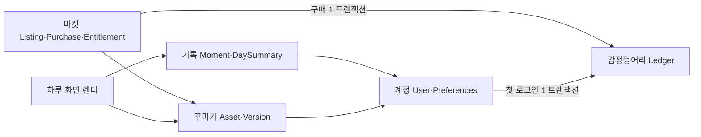

# 하루 꾸미기·디자인 마켓·감정덩어리 — 구조 설계 (스택 중립 초안)

- 상태: **설계 초안. 코드 구현·기술 스택 선택이 아니다.** 기준 `dev` `cb52350`. 실행 순서는 [PLAN_product-evolution](../plans/PLAN_product-evolution.md), 스택 후보는 [TECH_STACK_OPTIONS](TECH_STACK_OPTIONS.md).
- 입력: [PRD 초안](../PRD.md), [D 시안](../design/concepts/d-warm-pieces/)(`index.html`·`style.css`·`app.js`), [05 디자인 브리프](05_DESIGN_PROMPTS.md), 2026-11-02 사용자 응답(메인 전달).
- 표기: **[확정]** 사용자 확정, **[권고]** 이 문서의 제안, **[미정]** 사용자 결정 필요. 권고는 사용자 선택 전까지 요구가 아니다.

## 1. 확정·권고·미정

| 구분 | 내용 |
|---|---|
| [확정] | D 시안 UI/UX·테마를 기본으로 개발한다. |
| [확정] | 새 카피: "개인의 일상에서 순간을 기록하고 하루를 정리하여 스토리텔링을 만들어가는 감정정리 장소, pieceofdays" |
| [확정] | 개별 조각(순간) 수정이 필요하다. |
| [확정] | MVP 이후 다이어리 꾸미기: D 구조·기본 테마를 해치지 않고 사용자가 캐릭터/그림을 넣은 디자인을 마켓에 게시하고, 다른 사용자가 구매·적용한다. |
| [확정] | 내부 크레딧 이름은 **감정덩어리**. 회원가입이 아니라 **첫 로그인**에 10개, 디자인 구매에 1개 사용. 제작자는 적용하는 사람이 늘면 1개씩 누적하는 방향. |
| [확정] | 사용자 설정에서 폰트를 고른다. |
| [권고] | 기능명 "하루 꾸미기", 디자인 작품명 "하루풍경"(메인 추천, 사용자 미선택). 이 문서는 코드·데이터 이름에 영문 `decoration`/`design`만 쓰고 화면 문구는 고정하지 않는다. |
| [권고] | 구매 1건 = 소비자 −1 / 제작자 +1 **단일 거래**. 구입한 디자인 재적용·미리보기·본인 작품 적용은 추가 보상·차감 없음. 제작자는 자기 작품을 무료로 적용한다. |
| [권고] | "감정정리 장소"는 브랜드 방향이다. 기분 점수·진단·감정 통계 같은 새 요구를 만들지 않는다. |
| [미정] | 제작자 지급 정확한 조건(구매 기준인지 적용 기준인지, 상한·보류 기간), 감정덩어리의 다른 사용처, 환불·취소, 판매 중단, 탈퇴 시 원장·권리 처리, 유료 충전·환전 여부, 업로드 그림 저작권·신고 정책, 디자인 가격이 항상 1인지. |

## 2. 도메인 경계

**[권고] 초기 구조: 한 애플리케이션 안의 모듈 5개 + 단일 DB 트랜잭션.** 별도 서비스·캐시·메시지 큐·이벤트 버스는 두지 않는다.
모듈 경계는 "누가 어떤 테이블에 쓰는가"로만 지킨다. 인터페이스·플러그인 계층을 미리 만들지 않는다.

| 모듈 | 소유 데이터 | 쓰기 주체 | 다른 모듈과의 관계 |
|---|---|---|---|
| 계정 | `User`, `Preferences`(`font_key`, `applied_design`) | 본인 | 모든 모듈이 `user_id`만 참조 |
| 기록 | `DiaryMoment`, `DaySummary`, 사진 메타 | 본인 | 꾸미기·마켓을 **모른다**. 마켓은 기록을 읽지 못한다 |
| 꾸미기 | `DecorationAsset`, `DesignVersion`(manifest) | 제작자 | 기록과 무관. 렌더 시 manifest만 제공 |
| 마켓 | `DesignListing`, `Purchase`, `Entitlement` | 제작자(게시)·구매자(구매) | 구매 트랜잭션에서 감정덩어리 원장에 기록 |
| 감정덩어리 | `EmotionLedger`(+잠금용 `CreditAccount`) | 시스템 거래만 | 사용자가 직접 쓰지 않음 |



"이벤트"는 같은 트랜잭션 안의 함수 호출이다(첫 로그인 → 지급, 구매 → 권리+원장). 비동기 처리가 필요해지는 시점(예: 썸네일 생성 지연)에만 DB 기반 작업 표를 검토한다.

## 3. D 불변 영역과 장식 슬롯

### 3.1 바꾸지 않는 것 (D 불변)

D `style.css`·`app.js` 기준. 디자인 적용 여부와 무관하게 그대로다.

- 레이아웃: 상단(`.brand`·`.seg` 오늘/모아보기·`.btn-add`), 보드 머리(`.board-head` 날짜·조각 수), 한 줄(`.oneline`), 조각 격자(`.pieces` 2/3/4열), 달력(`.cal-grid`), 작성 대화상자(`.pop`), 첫날 빈 상태(`.first`).
- 색 토큰(`--bg`·`--surface`·`--ink`·`--muted`·`--accent`·`--focus` 등), UI 서체 `--font-ui`, 크기·간격·테두리·조각 기울기(±1° 이하, 움직이지 않음).
- 읽기·조작: 조각·한 줄·대화상자 표면은 불투명 `--surface`/메모 색 유지, 터치 대상 약 44px, focus 표시, `aria-live`, `prefers-reduced-motion`.

### 3.2 장식 전용 슬롯 [권고 v1]

| 슬롯 키 | 앵커 | 허용 | 금지 |
|---|---|---|---|
| `board.backdrop` | 보드 영역 뒤(z-index 최하) | 반복 무늬·배경 그림. 조각 사이 틈에서만 보인다 | 조각·한 줄 표면 위 덮기 |
| `board.corner` | `.board-head`의 시작/끝 모서리 바깥 | 캐릭터·스티커 최대 2개 | 날짜 제목·조각 수·버튼 영역 침범 |
| `oneline.tape` | `.oneline::before` 자리(테이프) | 테이프 그림 교체 | 한 줄 본문 영역 |
| `piece.sticker` | 조각 카드 모서리(바깥쪽 절반만) | 작은 스티커. 조각 n개마다 반복 규칙 | 시각·본문 텍스트 상자, 사진 위 |
| `empty.illust` | `.first`의 별 그림 자리 | 빈 상태 그림 교체 | 안내 문구·"첫 조각 붙이기" 버튼 |

규칙:

- 장식 레이어는 `aria-hidden`, `pointer-events: none`, 애니메이션 없음. 장식이 클릭·포커스·스크린리더 순서를 바꾸지 않는다.
- 위치는 앵커 기준 **상대 좌표**(0~1)와 앵커 크기 대비 최대 크기(%)로 저장한다. 픽셀 좌표를 저장하지 않는다.
- 렌더러가 375/768/1100px 이상 각 구간에서 슬롯별 안전 영역으로 잘라낸다(clamp). 안전 영역을 벗어나면 숨긴다. manifest는 구간별 숨김(`hide_below`)만 지정할 수 있다.
- 색 토큰·서체·레이아웃 변경은 v1에서 허용하지 않는다(테마 색 조정 허용 여부는 [미정]).

### 3.3 manifest (버전 고정 데이터)

디자인은 **데이터만** 담는다. 사용자 HTML/JS/CSS 템플릿으로 레이아웃을 교체하지 않는다.

```json
{
  "schema": 1,
  "base": "d-warm-pieces@1",
  "placements": [
    { "slot": "board.corner", "asset": "ast_…", "anchor": "end", "x": 0.8, "y": 0.1, "max_w": 0.25, "rotate": -4, "hide_below": 375 },
    { "slot": "piece.sticker", "asset": "ast_…", "corner": "top-end", "every": 3 }
  ]
}
```

- 서버가 저장 전에 스키마 검증: 알려진 `schema`·`base`·`slot`만, 숫자 범위(좌표 0~1, `rotate` ±15°, 슬롯별 개수 상한), `asset`은 같은 제작자 소유이고 검증 완료 상태.
- 게시된 `DesignVersion`은 **변경 불가**. 수정은 새 버전. 적용 사용자는 버전을 고정해 두고, 새 버전 갱신 방식(자동/선택)은 [미정]이며 권고는 사용자 선택 갱신.
- 렌더러가 모르는 `schema`/`base`/`slot`은 그 배치만 무시한다. D가 바뀌면 `base` 버전을 올리고 이전 manifest의 슬롯 대응표를 둔다.

## 4. 에셋 업로드·권한·노출

- 업로드 [권고]: 래스터(PNG/WebP)만 v1 허용, SVG는 스크립트 위험 때문에 [미정]. 확장자가 아닌 파일 시그니처로 형식 확인 → 서버에서 다시 인코딩(메타데이터 제거) → 크기·해상도·개수 상한 → 서비스가 만든 키로 이미지 저장소에 저장. 원본 파일명·경로를 키로 쓰지 않는다.
- 권한: 초안 디자인과 에셋은 제작자만 본다. 게시 버전의 에셋만 공개 읽기. 기록 사진과 장식 에셋은 **저장 위치(버킷/접두어)와 권한을 분리**한다.
- 원문 노출 금지: 마켓 미리보기·썸네일·상세 화면은 **고정 샘플 하루**(D 시안의 `shared/sample.js`와 같은 성격의 합성 데이터)만 렌더한다. 마켓 모듈은 기록 테이블을 조회할 권한·코드 경로가 없다. 썸네일 생성 입력은 `(manifest, 샘플 하루)`뿐이다.
- 신고·검수·저작권(캐릭터 그림 포함) 절차는 [미정]. 마켓 공개 전 결정해야 한다.

## 5. 적용·리셋·fallback

- 적용 상태는 `Preferences.applied_design = (listing_id, version_id) | null`. 사용자당 하나(날짜별 적용은 [미정]).
- 적용 가능 조건: 본인 작품이거나 `Entitlement`가 있음. 미리보기는 권리 없이 샘플 하루로만.
- "기본으로 되돌리기"는 `applied_design = null` → 기본 D.
- fallback: manifest 검증 실패, 에셋 로드 실패, 판매 중단·삭제, 권리 회수 시 **장식 없이 기본 D로 렌더**하고 기록 읽기·쓰기는 막지 않는다. 판매 중단 뒤 기존 구매자의 계속 사용 여부는 [미정] (권고: 이미 받은 버전은 계속 사용).

## 6. 감정덩어리 원장

### 6.1 데이터 [권고]

- `EmotionLedger(entry_id, user_id, delta 정수, reason, ref_type, ref_id, grant_key UNIQUE, created_at)` — **append-only**. 수정·삭제하지 않고 정정은 반대 부호의 새 행.
- 잔액의 권위는 원장 `SUM(delta)`. `CreditAccount(user_id PK, balance)`는 같은 트랜잭션에서 갱신하는 잠금·조회용 사본이며 `CHECK (balance >= 0)`. 둘이 다르면 원장이 맞다(정합성 점검 작업으로 확인).
- `reason`: `first_login_grant`, `design_purchase`, `design_sale`, (미정 사용처는 추가 시 정의).

### 6.2 첫 로그인 10개

- 기준은 인증 공급자 계정이 아니라 **서비스의 canonical `user_id`**. 같은 사람이 여러 로그인 수단을 연결해도 한 번.
- 로그인 성공 처리 한 트랜잭션: `CreditAccount` 행 확보 → `grant_key = 'first_login:{user_id}'`로 원장 삽입(유일 제약 충돌이면 아무것도 하지 않음) → 삽입된 경우에만 잔액 +10.
- 세션 재시도, 여러 기기 동시 첫 로그인, 인증 콜백 중복 호출 모두 유일 제약이 막는다. 애플리케이션의 "이미 지급했나" 조회만으로 막지 않는다.
- 단계: **MVP에 원장 최소형(첫 로그인 지급만)을 넣는 안을 제안**한다(사용처가 없으므로 잔액 표시 여부는 [미정]). MVP에 넣지 않으면 `User.first_login_at`만 기록하고 마켓 출시 마이그레이션에서 `first_login_at`이 있는 사용자에게 같은 `grant_key`로 소급 지급한다. 어느 쪽이든 같은 키를 쓰므로 이중 지급이 없다.
- 기존 로그인 사용자 소급 지급 자체, 탈퇴 후 재가입 시 재지급 여부는 [미정] (권고: 재가입은 새 `user_id`라 지급되므로, 막아야 한다면 별도 정책 필요).

### 6.3 디자인 구매 (1개) [권고]

한 트랜잭션, 클라이언트가 만든 `idempotency_key`:

1. 같은 `(buyer_id, idempotency_key)`의 `Purchase`가 있으면 그 결과를 그대로 반환(재시도 안전).
2. 구매자=제작자면 거부(본인 작품은 무료 적용).
3. `CreditAccount`를 `user_id` 오름차순으로 구매자·제작자 둘 다 `FOR UPDATE` 잠금(교착 방지).
4. `Entitlement UNIQUE(buyer_id, listing_id)`가 이미 있으면 "이미 보유"로 끝(차감 없음).
5. 구매자 잔액 < 1이면 "감정덩어리 부족"으로 끝(아무 행도 쓰지 않음).
6. `Purchase`, `Entitlement`, 원장 구매자 −1(`grant_key='purchase:{purchase_id}:buyer'`), 원장 제작자 +1(`…:creator`) 삽입, 두 잔액 갱신. 하나라도 실패하면 전부 롤백.

- 재적용·미리보기·버전 갱신·기기 변경은 원장을 건드리지 않는다. 제작자 +1은 **구매자별 첫 구매 1회**에서만 생긴다(적용 횟수가 아님).
- "적용하는 사람이 늘면"을 구매 기준으로 해석한 것은 [권고]다. 적용 기준 지급, 무료 배포 디자인, 지급 보류·상한, 환불 시 회수는 [미정].

## 7. 사용자 폰트 설정

- `Preferences.font_key`: 서버가 가진 **허용 목록**의 키만 저장. 모르는 키는 기본값으로 처리.
- 적용 범위: **기록 본문용 서체**(조각 글, 한 줄, 작성 입력란)만. 상단·탭·버튼·날짜 제목·시각 표기 등 UI 서체(`--font-ui`, `--font-hand`)는 D 고정.
- 각 폰트 항목: 라이선스 확인 결과(웹 동봉 허용 여부), 한국어 글리프 범위, fallback 스택(시스템 고딕 → `sans-serif`), 375px 휴대폰·데스크톱 실제 렌더 확인 기록. 확인 전 항목은 허용 목록에 넣지 않는다.
- 마켓 디자인 적용은 `font_key`를 바꾸지 않는다. manifest에는 폰트 필드가 없다.

## 8. 하지 않는 것

- 사용자 HTML/CSS/JS 실행, 레이아웃 템플릿 교체, 색 토큰 덮어쓰기(v1).
- 기분 점수·감정 진단·통계.
- 마이크로서비스, 별도 캐시·큐, 원장 전용 DB, 범용 플러그인/테마 엔진.
- 현금 충전·환전(도입하려면 별도 법률·결제 검토 필요, 이 문서 범위 밖).
